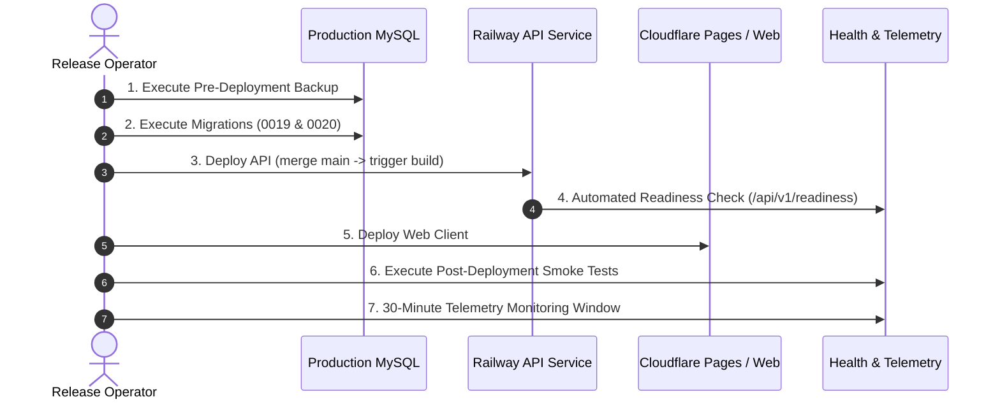

# HAZA AIOS — Epic 10N: Production Deployment & Rollback Runbook

**Document ID:** `HAZA-AIOS-EPIC10N-RUNBOOK-001`  
**Repository:** `HAZA-AIOS/haza-aios`  
**Target Release:** Epic 10N Consolidated Release  
**Target Version Tag:** `v0.10.14-epic10n`  
**Target Baseline Tag:** `v0.10.13-epic10m`  
**Date:** October 23, 2026  
**Status:** **PROCEDURAL RUNBOOK — DO NOT EXECUTE WITHOUT OPERATOR SIGN-OFF**

> [!CAUTION]
> **OPERATIONAL POLICY NOTICE**  
> This runbook is procedural documentation for future release execution. Do not execute any deployment, migration, or tagging steps during Epic 10N development phases.

---

## 1. Pre-Deployment Prerequisites

Before initiating any deployment activities, verify that all conditions below are met:

- [ ] **Operator Authorization:** Explicit, written approval from the project owner authorizing Epic 10N deployment.
- [ ] **Release Blocker RB-001 (Data Integrity):** Code remediated and verified with 10/10 focused regression tests. No fabricated fallbacks for DOB, hireDate, admissionDate, guardian contact, or attendance status.
- [ ] **Release Blocker RB-002A (Proxy Source Correction):** Code remediated and verified with 18 focused regression tests (TP-001 through TP-018). `env.ts` preserves `"cloudflare"` mode, and `rate-limiter.ts` validates legitimate Cloudflare origin before accepting `CF-Connecting-IP`.
- [ ] **Release Blocker RB-002B (Proxy Operational Verification):** Operator must inspect Cloudflare and Railway console to confirm:
  1. Direct `api-production-367e.up.railway.app` generated public domain is **deleted** in Railway Settings.
  2. Cloudflare Proxied mode (Orange Cloud) is active on `api.haza-aios.com` pointing to `gpc9vf9z.up.railway.app`.
  3. Railway service environment has `TRUST_PROXY=cloudflare`.
- [ ] **Release Blocker RB-003 (Migration & Backup Verification):** Operator must perform:
  1. Dry-run of migrations 0019 and 0020 against an isolated staging/clone database.
  2. Successful pre-deployment full logical backup (`mysqldump`) with table row count verification.
  3. Verification that restored copy matches live production record counts.
- [ ] **Local Quality Gates:** All local tests and builds verified (592 tests passing across web and api, 0 typecheck errors, db:check clean).
- [ ] **CI Pipeline Acceptance:** GitHub Actions workflow `HAZA AIOS — Continuous Integration` passing on `feature/epic-10n-system-hardening`.
- [ ] **Git Synchronization:** Working tree clean; feature branch synchronized with `origin`.
- [ ] **Infrastructure Health:** Railway production API service and Cloudflare DNS operational with normal latency and zero elevated error rates.
- [ ] **Pre-Deployment Backup:** Fresh, verified physical or logical database dump created and stored in secure offsite storage.
- [ ] **Migration Dry-Run:** Migrations 0019 and 0020 executed and validated against a production-clone database.

---

## 2. Pre-Deployment Configuration Review

Review the environment variables on the Railway production API service:

| Variable | Required Setting | Purpose |
| :--- | :--- | :--- |
| `NODE_ENV` | `production` | Enforces production runtime optimizations and security guards. |
| `TRUST_PROXY` | `cloudflare` (or verified Railway proxy CIDR) | Required by `SEC-002A` to prevent IP spoofing while enabling Cloudflare client IP recovery. |
| `DATABASE_HOST` | Production MySQL internal host | Production database connection. |
| `DATABASE_NAME` | `haza_aios` | Primary production database name. |
| `PORT` | Assigned by Railway (`PORT`) | HTTP server listening port. |
| `LOG_LEVEL` | `info` | Balanced operational logging without leaking sensitive payloads. |

> [!WARNING]
> Do NOT set `TRUST_PROXY=true` in production without specifying CIDR ranges or `cloudflare`. Broad private CIDR trust creates IP spoofing vulnerabilities.

---

## 3. Recommended Production Deployment Sequence

The deployment must follow a structured, sequential workflow to ensure data consistency and zero-downtime availability.



### Step 1: Production Database Backup
Execute a complete database backup prior to applying any schema changes:
```bash
# Example mysqldump command via secure production bastion or Railway CLI
mysqldump -h $PROD_DB_HOST -u $PROD_DB_USER -p$PROD_DB_PASSWORD \
  --single-transaction --quick --routines --triggers \
  haza_aios > pre_epic10n_backup_$(date +%Y%m%d_%H%M%S).sql
```
Verify the backup file size and integrity before proceeding.

### Step 2: Database Migration Execution
Apply pending additive migrations (0019 and 0020):
1. **Migration 0019 (`0019_chunky_starjammers.sql`):** Creates persistent sequence tables and constraint updates.
2. **Migration 0020 (`0020_backfill_portal_request_identifiers.sql`):** Idempotently backfills legacy portal update request identifiers.
```bash
# Run migration runner from deployed API service or controlled runner
npm run db:migrate -w apps/api
```
Verify migration status:
```bash
npm run db:migrate:status -w apps/api
```

### Step 3: API Service Deployment
1. Fast-forward merge `feature/epic-10n-system-hardening` into `develop`.
2. Merge `develop` into `main`.
3. Push `main` to `origin`.
4. Railway will automatically detect the push to `main` and execute the build (`npm install --include=dev && npm run build`).
5. Monitor Railway container logs for successful startup and readiness:
   - Verify log message: `database_connection_established`
   - Verify log message: `server_listening` on designated port.

### Step 4: Web Client Deployment
1. Cloudflare Pages or web container deployment initiates on push to `main`.
2. Vite compiles production bundle (`npm run build:web`).
3. Assets are deployed to Cloudflare edge CDN.

### Step 5: Post-Deployment Verification & Smoke Tests
Perform live operational verification across key subsystems:
1. **Health Check:** `GET https://api.haza-aios.com/api/v1/health` -> HTTP 200 `{ status: "ok" }`.
2. **Readiness Check:** `GET https://api.haza-aios.com/api/v1/readiness` -> HTTP 200 `{ status: "ready" }`.
3. **Security Headers:** Inspect response headers on `https://api.haza-aios.com/` for HSTS, CSP, and X-Frame-Options.
4. **Rate Limiting:** Issue rapid requests to `/api/v1/auth/login` to confirm HTTP 429 after threshold.
5. **Attendance Routes:** Verify `/workspace/education/attendance` and legacy redirect `/attendance` resolve to canonical view.
6. **Double-Submit Prevention:** Verify submit button disable behavior on an enquiry or marks entry modal.
7. **Roster Pagination:** Navigate to Student Directory and verify page controls and bounded data display.

### Step 6: Tagging Reconciliation
Once the deployment is verified healthy:
1. **Tag Epic 10M Baseline:**
   ```bash
   git tag -a v0.10.13-epic10m eb6c5d9df71c12a975b462418ae0d6fdf5a89113 -m "Release Epic 10M — Financial Management Enhancement & Direct Subroutes"
   git push origin v0.10.13-epic10m
   ```
2. **Tag Epic 10N Release:**
   ```bash
   git tag -a v0.10.14-epic10n HEAD -m "Release Epic 10N — System Hardening & Cross-Module Auditing"
   git push origin v0.10.14-epic10n
   ```

---

## 4. Rollback and Recovery Procedures

If critical defects or service interruptions occur post-deployment, follow the appropriate recovery tier below.

> [!CRITICAL]
> **IMPORTANT SCHEMA PRINCIPLE**  
> Rolling back application code (Git revert or redeploying an older container) does NOT automatically reverse database schema migrations. Because Migrations 0019 and 0020 are strictly additive (adding new tables/columns and backfilling NULL values), older code versions remain backward-compatible with the migrated database schema.

### Recovery Tier 1: Application Code Rollback (Low Impact)
If an application bug is discovered but the database remains intact:
1. Re-deploy the accepted Epic 10M baseline commit (`eb6c5d9df71c12a975b462418ae0d6fdf5a89113`) via Railway deployment history or Git revert.
2. Older API and Web containers continue functioning normally because all Epic 10N database changes are backward-compatible.
3. No database restore is required.

### Recovery Tier 2: Forward-Fix Strategy (Preferred for Minor Issues)
If a defect is isolated (e.g. rate-limit threshold adjustment, minor UI styling):
1. Create a hotfix branch from `main`: `hotfix/epic-10n-patch`.
2. Implement targeted remediation.
3. Run local quality gates (`typecheck`, `test`).
4. Merge to `main` and trigger automated CI deployment.

### Recovery Tier 3: Complete Database Rollback (Catastrophic Data Corruption Only)
In the highly improbable event of unrecoverable data corruption during migration:
1. Immediately place the API service in maintenance mode (`MAINTENANCE_MODE=true`).
2. Terminate all active database connections.
3. Restore the pre-deployment database dump created in Step 1:
   ```bash
   mysql -h $PROD_DB_HOST -u $PROD_DB_USER -p$PROD_DB_PASSWORD haza_aios < pre_epic10n_backup_*.sql
   ```
4. Redeploy the Epic 10M baseline commit (`eb6c5d9df71c12a975b462418ae0d6fdf5a89113`).
5. Re-enable traffic and verify database consistency.

---

## 5. Post-Deployment Monitoring & Sign-Off

Monitor system metrics for a minimum of 30 minutes following release:
- API response latency (p50 < 100ms, p99 < 500ms).
- HTTP error rate (< 0.1% 5xx responses).
- Database CPU and connection pool utilization (< 40%).
- Authentication failure and rate-limiting log alerts.

Upon successful completion of the monitoring window, the release operator signs off on Epic 10N production acceptance.
