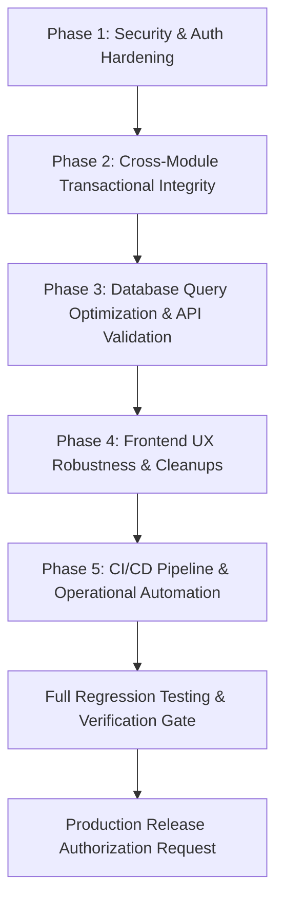

# HAZA AIOS — Epic 10N: System Hardening & Cross-Module Implementation Plan

**Document ID:** `HAZA-AIOS-EPIC10N-PLAN-001`  
**Repository:** `HAZA-AIOS/haza-aios`  
**Target Branch:** `feature/epic-10n-system-hardening`  
**Accepted Production Baseline:** `eb6c5d9df71c12a975b462418ae0d6fdf5a89113`  
**Date:** October 19, 2026  
**Status:** **Pending Review & Approval** (Execution Halted at Gate)  

---

## 1. Executive Summary

This implementation plan defines the structured, phased remediation sequence to address the 16 findings documented in [`docs/epic-10n/EPIC-10N-AUDIT-MATRIX.md`](./EPIC-10N-AUDIT-MATRIX.md).

Remediations are prioritized by severity and risk:
1. **Phase 1: Core Security & Authentication Hardening** (`SEC-001`, `SEC-002`, `SEC-003`, `SEC-004`)
2. **Phase 2: Cross-Module Lifecycle & Transactional Integrity** (`INT-001`, `INT-002`, `INT-003`, `INT-004`)
3. **Phase 3: Database Query Optimization & API Pre-Validation** (`DB-001`, `DB-002`, `DB-003`, `DB-004`)
4. **Phase 4: Frontend UX Robustness & Route Cleanup** (`UX-001`, `UX-002`)
5. **Phase 5: Operational Automation & CI/CD Pipeline** (`OPS-001`, `OPS-002`)

In accordance with mandatory safety rules, **execution stops after publishing this plan**. No production deployments or broad remediations will be initiated until this plan is formally approved by the operator.

---

## 2. Prioritized Remediation Sequence

### Phase 1: Core Security & Authentication Hardening
- **Objective:** Eliminate actor identity spoofing, add authentication rate limiting, and harden security headers.
- **Status:** **Completed & Verified** (October 20, 2026)
- **Remediated Findings:** `SEC-001`, `SEC-002`, `SEC-003`
- **Tasks Executed:**
  1. **Fix `SEC-001` (Actor Identity Enforcement):**
     - Completely removed `actor(request, fallback)` helper from [`apps/api/src/modules/education/education.module.ts`](file:///c:/HAZA-APPS/HAZA-AIOS/apps/api/src/modules/education/education.module.ts).
     - Authoritative actor resolution strictly derives from `auth.user.id`, `membership.role`, and `auth.user.email`.
     - Client-supplied `payload.actor` is completely ignored across financial mutations, portal request submissions, admissions, and communication routes.
  2. **Fix `SEC-002` (Authentication Rate Limiting):**
     - Implemented `InMemoryRateLimiterStore` in [`apps/api/src/middleware/rate-limiter.ts`](file:///c:/HAZA-APPS/HAZA-AIOS/apps/api/src/middleware/rate-limiter.ts) using sliding-window timestamp tracking.
     - Protected `/api/v1/auth/login` (5 failed attempts/min per account/IP, 30 attempts/min per IP), `/register` (5/hr), `/forgot-password` (3/15m per account, 15/15m per IP), and `/reset-password` (5/15m).
     - Added configurable `trustProxy` setting in `apps/api/src/config/env.ts` to neutralize forged forwarding headers when direct/untrusted.
     - Returns HTTP 429 `TOO_MANY_REQUESTS` with standard `Retry-After` header and response JSON.
  3. **Fix `SEC-003` (Security Headers Hardening):**
     - Updated [`apps/api/src/middleware/security.ts`](file:///c:/HAZA-APPS/HAZA-AIOS/apps/api/src/middleware/security.ts) to emit:
       - `content-security-policy: default-src 'none'; frame-ancestors 'none'`
       - `strict-transport-security: max-age=31536000` on verified HTTPS responses (omitted on local HTTP development to prevent accidental local cache lockouts).
       - Preserved `x-content-type-options: nosniff`, `x-frame-options: DENY`, `referrer-policy: no-referrer`, and `permissions-policy`.
- **Verification Evidence:** `apps/api/tests/epic10n-security-hardening.integration.test.ts` (14/14 tests passing).
- **Quality Gates:** `typecheck:api` (0 errors), `typecheck:web` (0 errors), `build:api` (passed), `build:web` (passed).

---

### Phase 2: Cross-Module Lifecycle & Transactional Integrity
- **Objective:** Guarantee atomicity for student admissions conversion, student archival, transfers, and sequence numbers.
- **Tasks:**
  1. **Fix `INT-001` (Admissions Conversion Transaction Boundary):**
     - Wrap `convertApplicationToEnrollment` in [`apps/api/src/modules/education/sis-admissions.service.ts`](file:///c:/HAZA-APPS/HAZA-AIOS/apps/api/src/modules/education/sis-admissions.service.ts) within `withTransaction(this.database, async ({ tx }) => { ... })`.
     - Ensure student creation, enrollment creation, and application status update succeed or rollback atomically.
  2. **Fix `INT-002` (Student Archival Lifecycle Coherency):**
     - In [`apps/api/src/modules/education/sis.service.ts`](file:///c:/HAZA-APPS/HAZA-AIOS/apps/api/src/modules/education/sis.service.ts) `deleteStudent`:
       - Check for unpaid invoices; if found, log warning or require confirmation.
       - Inside transaction, set `students.status = 'archived'` AND update active records in `enrollments` to `status = 'archived'`.
       - Exclude archived enrollments from active attendance sessions and gradebooks.
  3. **Fix `INT-003` (Section Transfer Atomicity & Audit Trail):**
     - In `sis.service.ts` `transferStudent`: wrap previous enrollment deactivation and new enrollment creation in a single transaction.
     - Record transfer audit entry noting origin and target section IDs.
  4. **Fix `INT-004` (Admission & Employee Number Concurrency Guard):**
     - Introduce atomic sequence reservation or retry loop on unique collision to prevent duplicate generation failures under concurrent load.
- **Dependencies:** Phase 1 complete.
- **Estimated Effort:** Low regression risk; strictly strengthens data consistency.

---

### Phase 3: Database Query Optimization & API Pre-Validation
- **Objective:** Eliminate full-table scans with in-memory filtering, introduce SQL-level filters, and pre-validate mutation payloads.
- **Tasks:**
  1. **Fix `DB-001` (SQL-Level Where Clauses):**
     - Refactor `listAttendanceSessions`, `listEnrollments`, `teachingAssignments` in [`apps/api/src/modules/education/sis.service.ts`](file:///c:/HAZA-APPS/HAZA-AIOS/apps/api/src/modules/education/sis.service.ts).
     - Construct dynamic Drizzle SQL `where(and(...))` clauses combining all passed filter criteria (`academicYearId`, `gradeId`, `sectionId`, `status`, `date`).
     - Remove in-memory `.filter()` passes over unconstrained table scans.
  2. **Fix `DB-002` (Structured Request Body Validation):**
     - Create `apps/api/src/modules/education/validation/sis-validation.ts`.
     - Implement validation functions for `CreateStudentInput`, `CreateEnrollmentInput`, `CreateAcademicYearInput`, `CreateAttendanceSessionInput`.
     - Validate before service calls; return HTTP 400 `VALIDATION_FAILED` on missing/invalid properties.
  3. **Fix `DB-003` & `DB-004` (Safe Pagination Defaults & Recurring Billing Batch Safety):**
     - Add default `limit: 100` with optional pagination parameters to student and enrollment queries.
     - Wrap recurring invoice generation in batched transaction chunks (e.g. 50 students per chunk) with execution summaries.
- **Dependencies:** Phase 2 complete.
- **Estimated Effort:** Moderate; requires updating test fixtures if payload validation catches previously loose dummy objects.

---

### Phase 4: Frontend UX Robustness & Route Cleanup
- **Objective:** Clean up duplicate route declarations and protect form dialogs against double submissions.
- **Tasks:**
  1. **Fix `UX-001` (App.tsx Duplicate Case Cleanup):**
     - Remove redundant duplicate cases for `/workspace/education/attendance`, `/attendance/mark`, `/attendance/history` in [`apps/web/src/App.tsx`](file:///c:/HAZA-APPS/HAZA-AIOS/apps/web/src/App.tsx) lines 549–570.
  2. **Fix `UX-002` (Modal Double-Submit Disabling):**
     - Audit admissions and examination modal dialogs.
     - Ensure submit buttons bind `disabled={isSubmitting}` and render `<RefreshCw className="animate-spin" />` during network operations.
- **Dependencies:** Phase 3 complete.
- **Estimated Effort:** Low.

---

### Phase 5: CI/CD Pipeline & Operational Automation
- **Objective:** Automate quality gates on GitHub and establish release tagging protocol.
- **Tasks:**
  1. **Fix `OPS-001` (GitHub Actions CI Workflow):**
     - Create [`.github/workflows/ci.yml`](file:///c:/HAZA-APPS/HAZA-AIOS/.github/workflows/ci.yml).
     - Configure trigger on `push` and `pull_request` to `develop` and `main`.
     - Steps:
       - Checkout code
       - Setup Node.js 22 with npm cache
       - Run `npm ci`
       - Run `npm run typecheck:api`
       - Run `npm run typecheck:web`
       - Run `npm run test:run -w apps/api`
       - Run `npm run test:run -w apps/web`
       - Run `npm run build:api`
       - Run `npm run build:web`
  2. **Fix `OPS-002` (Epic 10M Production Tagging):**
     - Present proposal to tag production commit `eb6c5d9df71c12a975b462418ae0d6fdf5a89113` as `v0.10.13-epic10m` upon explicit operator authorization.
- **Dependencies:** None.

---

## 3. Files Expected to Change

| File Path | Type | Scope / Changes |
| :--- | :---: | :--- |
| `apps/api/src/modules/education/education.module.ts` | Modified | Fix actor spoofing (`SEC-001`), add validation calls (`DB-002`) |
| `apps/api/src/middleware/rate-limiter.ts` | **New** | In-memory token bucket / sliding window rate limiter (`SEC-002`) |
| `apps/api/src/middleware/security.ts` | Modified | Add HSTS and CSP security headers (`SEC-003`) |
| `apps/api/src/app.ts` | Modified | Wire rate-limiting middleware to auth routes (`SEC-002`) |
| `apps/api/src/modules/education/sis-admissions.service.ts` | Modified | Wrap enrollment conversion in `withTransaction` (`INT-001`) |
| `apps/api/src/modules/education/sis.service.ts` | Modified | Coordinated archival (`INT-002`), transfer transaction (`INT-003`), SQL where clauses (`DB-001`) |
| `apps/api/src/modules/education/sis-finance.service.ts` | Modified | SQL where clauses (`DB-001`), batch recurring billing safety (`DB-004`) |
| `apps/api/src/modules/education/validation/sis-validation.ts` | **New** | Centralized pre-validation helpers for SIS inputs (`DB-002`) |
| `apps/web/src/App.tsx` | Modified | Remove duplicate attendance route cases (`UX-001`) |
| `apps/web/src/pages/workspace/education/admissions/AdmissionsPage.tsx` | Modified | Form double-submit button disable guards (`UX-002`) |
| `.github/workflows/ci.yml` | **New** | Automated CI workflow for PRs and pushes (`OPS-001`) |

---

## 4. Testing Strategy

1. **Unit & Typecheck Validation:**
   - `npm run typecheck:api` → 0 errors
   - `npm run typecheck:web` → 0 errors
2. **Security Integration Testing:**
   - Create `apps/api/tests/epic10n-security-hardening.integration.test.ts`:
     - Test actor spoofing rejection (assert client-provided actor is ignored).
     - Test rate-limiting enforcement on `/api/v1/auth/login` (assert HTTP 429 after threshold).
     - Test security headers present in responses.
3. **Cross-Module Transactional Regression Testing:**
   - Test application conversion rollback on simulated failure.
   - Test student archival cascades to enrollment deactivation.
   - Test section transfer atomicity and roster synchronization.
4. **Existing Regression Test Suites:**
   - Run all existing 22 automated tests across API and Web:
     - `epic10m-financial-management.integration.test.ts`
     - `sis-finance-communication-portal.integration.test.ts`
     - `FeesFinancePage.epic10m.test.tsx`
     - `FeesFinancePage.test.tsx`
     - All prior SIS test suites.
5. **Build Verification:**
   - `npm run build:api` → Clean exit code 0
   - `npm run build:web` → Clean exit code 0

---

## 5. Database Migration Requirements

- **Migration Required:** **No.**
- All Phase 1 through 5 remediations utilize existing schema tables, columns, indexes, and relations.
- Zero destructive DDL, zero schema modifications, and zero data migrations are required.
- If persistent operational audit logging (`SEC-004`) is expanded beyond existing `security_events` in a future enhancement, a dedicated additive migration will be proposed separately.

---

## 6. Acceptance Criteria

| ID | Criteria | Verification Method |
| :--- | :--- | :--- |
| **AC-01** | Client cannot forge audit actor identity or role in education mutations. | Integration test passes asserting authoritative session actor is recorded. |
| **AC-02** | Authentication endpoints reject automated brute-force attacks with HTTP 429. | Rate-limiter integration test passes. |
| **AC-03** | Application-to-enrollment conversion executes inside atomic database transaction. | Simulated failure test passes verifying complete rollback of partial records. |
| **AC-04** | Archiving a student automatically transitions active enrollments out of active state. | Query verification test confirms student excluded from active section rosters. |
| **AC-05** | Attendance, enrollment, and teaching queries execute SQL-level filters. | Integration tests verify correct filtered results; no in-memory full table scans. |
| **AC-06** | Duplicate router cases removed from `App.tsx` with zero broken routes. | Web typecheck and component router tests pass. |
| **AC-07** | GitHub Actions CI workflow configured and valid. | YAML schema check and CI run verification. |
| **AC-08** | All existing 22+ tests pass with 100% success; zero TypeScript errors. | Full test suite execution report. |

---

## 7. Rollback and Recovery Considerations

1. **Git Isolation:**
   - All work is isolated on branch `feature/epic-10n-system-hardening`.
   - Production `main` remains untouched at `eb6c5d9df71c12a975b462418ae0d6fdf5a89113`.
2. **Schema Safety:**
   - Because no database schema migrations are introduced, rollback at any stage requires only switching Git branches (`git checkout develop` or `git checkout main`).
3. **Zero Downtime:**
   - The remediations are backward-compatible with existing frontend API contracts and database records.
