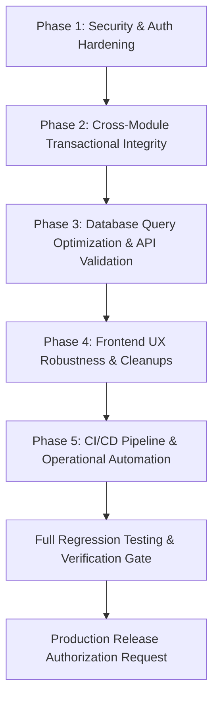

# HAZA AIOS — Epic 10N: System Hardening & Cross-Module Implementation Plan

**Document ID:** `HAZA-AIOS-EPIC10N-PLAN-001`  
**Repository:** `HAZA-AIOS/haza-aios`  
**Target Branch:** `feature/epic-10n-system-hardening`  
**Accepted Production Baseline:** `eb6c5d9df71c12a975b462418ae0d6fdf5a89113`  
**Date:** October 19, 2026  
**Status:** **Pending Review & Approval** (Execution Halted at Gate)  

---

## 1. Executive Summary

This implementation plan defines the structured, phased remediation sequence to address the 16 findings documented in [`docs/epic-10n/EPIC-10N-AUDIT-MATRIX.md`](./EPIC-10N-AUDIT-MATRIX.md).

Remediations are prioritized by severity and risk:
1. **Phase 1: Core Security & Authentication Hardening** (`SEC-001`, `SEC-002`, `SEC-003`, `SEC-004`)
2. **Phase 2: Cross-Module Lifecycle & Transactional Integrity** (`INT-001`, `INT-002`, `INT-003`, `INT-004`)
3. **Phase 3: Database Query Optimization & API Pre-Validation** (`DB-001`, `DB-002`, `DB-003`, `DB-004`)
4. **Phase 4: Frontend UX Robustness & Route Cleanup** (`UX-001`, `UX-002`)
5. **Phase 5: Operational Automation & CI/CD Pipeline** (`OPS-001`, `OPS-002`)

In accordance with mandatory safety rules, **execution stops after publishing this plan**. No production deployments or broad remediations will be initiated until this plan is formally approved by the operator.

---

## 2. Prioritized Remediation Sequence

### Phase 1: Core Security & Authentication Hardening
- **Objective:** Eliminate actor identity spoofing, add authentication rate limiting, and harden security headers.
- **Status:** **Completed & Verified** (October 20, 2026)
- **Remediated Findings:** `SEC-001`, `SEC-002`, `SEC-003`
- **Tasks Executed:**
  1. **Fix `SEC-001` (Actor Identity Enforcement):**
     - Completely removed `actor(request, fallback)` helper from [`apps/api/src/modules/education/education.module.ts`](file:///c:/HAZA-APPS/HAZA-AIOS/apps/api/src/modules/education/education.module.ts).
     - Authoritative actor resolution strictly derives from `auth.user.id`, `membership.role`, and `auth.user.email`.
     - Client-supplied `payload.actor` is completely ignored across financial mutations, portal request submissions, admissions, and communication routes.
  2. **Fix `SEC-002` & `SEC-002A` (Authentication Rate Limiting & Proxy Trust Boundaries):**
     - Implemented `InMemoryRateLimiterStore` in [`apps/api/src/middleware/rate-limiter.ts`](file:///c:/HAZA-APPS/HAZA-AIOS/apps/api/src/middleware/rate-limiter.ts) using sliding-window timestamp tracking.
     - Protected `/api/v1/auth/login` (5 failed attempts/min per account/IP, 30 attempts/min per IP), `/register` (5/hr), `/forgot-password` (3/15m per account, 15/15m per IP), and `/reset-password` (5/15m).
     - Added configurable `trustProxy` setting in `apps/api/src/config/env.ts` requiring explicit configuration (never defaults to true on `production`).
     - Implemented IP normalization, IPv4/IPv6 CIDR matching (`DEFAULT_TRUSTED_PROXY_RANGES`, `CLOUDFLARE_PROXY_RANGES`), and socket origin verification.
     - Traverses multi-hop `X-Forwarded-For` right-to-left to find authentic client; only trusts `CF-Connecting-IP` when verified upstream proxy is Cloudflare.
     - Returns HTTP 429 `TOO_MANY_REQUESTS` with standard `Retry-After` header and response JSON.
  3. **Fix `SEC-003` & `SEC-003A` (Security Headers Hardening & HSTS Policy):**
     - Updated [`apps/api/src/middleware/security.ts`](file:///c:/HAZA-APPS/HAZA-AIOS/apps/api/src/middleware/security.ts) to emit:
       - `content-security-policy: default-src 'none'; frame-ancestors 'none'`
       - `strict-transport-security: max-age=31536000` on verified HTTPS responses (direct TLS or forwarded HTTPS arriving from a verified trusted proxy socket). Intentionally omits `includeSubDomains` and `preload`.
       - Preserved `x-content-type-options: nosniff`, `x-frame-options: DENY`, `referrer-policy: no-referrer`, and `permissions-policy`.
- **Verification Evidence:** `apps/api/tests/epic10n-security-hardening.integration.test.ts` (27/27 tests passing).
- **Quality Gates:** `typecheck:api` (0 errors), `typecheck:web` (0 errors), `build:api` (passed), `build:web` (passed).

---

### Phase 2: Cross-Module Lifecycle & Transactional Integrity
- **Status:** **Completed & Hardened** (October 20, 2026)
- **Objective:** Guarantee atomicity and concurrency safety for student admissions conversion, student archival, transfers, and sequence numbers.
- **Completed Tasks:**
  1. **Fix `INT-001` (Admissions Conversion Transaction Boundary & Concurrency Lock):**
     - Wrapped `convertApplicationToEnrollment` in [`apps/api/src/modules/education/sis-admissions.service.ts`](file:///c:/HAZA-APPS/HAZA-AIOS/apps/api/src/modules/education/sis-admissions.service.ts) within `withTransaction(this.database, async ({ tx }) => { ... })`.
     - Added row-level locking via `SELECT ... FOR UPDATE` on the application record to serialize competing requests.
     - Implemented in-transaction idempotency detection: returns established student/enrollment records without duplicate writes if already converted.
     - Enforced atomic conditional status transition `SET status = 'enrolled' WHERE status != 'enrolled'` with affected-row count check (`affectedRows === 1`), throwing 409 Conflict on race conditions.
     - Student creation, enrollment creation, fee package assignment, and application status update succeed or rollback atomically.
  2. **Fix `INT-002` (Student Archival Lifecycle Coherency & Atomicity):**
     - In [`apps/api/src/modules/education/sis.service.ts`](file:///c:/HAZA-APPS/HAZA-AIOS/apps/api/src/modules/education/sis.service.ts) `deleteStudent`:
       - Wrapped entirely in `withTransaction`. Locked student with `SELECT id, student_status as status FROM students ... FOR UPDATE`.
       - Pre-flight dues check validates student invoices under lock, blocking archival on positive balances unless `forceWithOutstandingDues: true` is passed.
       - Inside `withTransaction`, conditionally transitions student status to `archived` (`WHERE student_status != 'archived'`) verifying `affectedRows === 1` AND active records in `enrollments` to `status = 'dropped'`.
       - Excluded archived students from recurring billing in `SisFinanceService.generateRecurringInvoices`.
       - Strictly preserved all historical attendance, examination marks, and invoice history.
  3. **Fix `INT-003` (Section Transfer Atomicity, Concurrency Lock & Single Active Invariant):**
     - In `sis.service.ts` `transferStudent`: wrapped entirely in `withTransaction`.
     - Enforced row-level locking on the student (`SELECT id, student_status as status FROM students ... FOR UPDATE`) and the active enrollment (`SELECT ... FROM enrollments ... WHERE ... AND enrollment_status = 'active' FOR UPDATE`).
     - Strictly validates destination section existence within workspace and grade alignment.
     - Conditionally transitioned active enrollment to `transferred` (`WHERE enrollment_status = 'active'`) with affected-row check (`affectedRows === 1`), aborting before destination insertion on race conflict.
     - Inserted new enrollment with status `active`, maintaining single active enrollment invariant.
     - Emits structured audit log recording before/after section snapshots with safe actor foreign-key resolution.
  4. **Fix `INT-004` (Admission, Staff, Enquiry & Application Number Concurrency Guards):**
     - Added additive database migration `0019_portal_requests_unique_identifiers.sql` promoting `reference_number` and `application_number` to columns with workspace-scoped unique constraints on `portal_update_requests`.
     - Refactored `nextAdmissionNumber`, `nextEmployeeNumber`, `nextEnquiryNumber`, and `nextApplicationNumber` to query sequence records with `FOR UPDATE` and parse the true sequence maximum using regular expressions.
     - Wrapped creation operations in bounded retry loops (up to 12 attempts) with randomized jitter backoff.
     - Broadened `isUniqueConstraintError` to capture MySQL unique constraints (1062 / `ER_DUP_ENTRY`), deadlocks (1213 / `ER_LOCK_DEADLOCK`), and lock timeouts (1205 / `ER_LOCK_WAIT_TIMEOUT`).
- **Verification Evidence:** `apps/api/tests/epic10n-transactional-integrity.integration.test.ts` (20/20 tests passing, 100%).
- **Quality Gates:** `typecheck:api` (0 errors), `typecheck:web` (0 errors), `build:api` (passed), `build:web` (passed).
- **Report:** [`docs/epic-10n/EPIC-10N-PHASE-2-TRANSACTIONAL-INTEGRITY.md`](file:///c:/HAZA-APPS/HAZA-AIOS/docs/epic-10n/EPIC-10N-PHASE-2-TRANSACTIONAL-INTEGRITY.md).

---

### Phase 3: Database Query Optimization & API Pre-Validation
- **Objective:** Eliminate full-table scans with in-memory filtering, introduce SQL-level filters, pre-validate mutation payloads, bound pagination safely, and serialize recurring billing batches.
- **Tasks:**
  1. **Fix `DB-001` (SQL-Level Where Clauses & Query Optimization):**
     - Refactored `listAttendanceSessions`, `listEnrollments`, `listTeachingAssignments`, `listTimetableEntries`, `listStudents`, `listStaff` in [`apps/api/src/modules/education/sis.service.ts`](file:///c:/HAZA-APPS/HAZA-AIOS/apps/api/src/modules/education/sis.service.ts).
     - Refactored `listInvoices`, `listPayments`, `listExpenses`, `listIncomes` in [`apps/api/src/modules/education/sis-finance.service.ts`](file:///c:/HAZA-APPS/HAZA-AIOS/apps/api/src/modules/education/sis-finance.service.ts).
     - Refactored `listEnquiries`, `listApplications` in [`apps/api/src/modules/education/sis-admissions.service.ts`](file:///c:/HAZA-APPS/HAZA-AIOS/apps/api/src/modules/education/sis-admissions.service.ts).
     - Eliminated in-memory `.filter()` passes; constructed dynamic Drizzle SQL `where(and(...))` clauses combining all filter criteria directly in the database.
  2. **Fix `DB-002` (Structured Request Body Validation & Prototype Pollution Defense):**
     - Created [`apps/api/src/modules/education/validation/sis-validation.ts`](file:///c:/HAZA-APPS/HAZA-AIOS/apps/api/src/modules/education/validation/sis-validation.ts).
     - Implemented strict input validation across all education mutations (`academicYear`, `grade`, `section`, `student`, `enrollment`, `transfer`, `attendanceSession`, `attendanceRecords`, `staff`, `teachingAssignment`, `enquiry`, `application`, `invoice`, `payment`, `recurringInvoices`, `expense`, `income`).
     - Hardened against prototype pollution (`__proto__`, `constructor`, `prototype`).
     - Wired validation across all education mutation routes in [`apps/api/src/modules/education/education.module.ts`](file:///c:/HAZA-APPS/HAZA-AIOS/apps/api/src/modules/education/education.module.ts) and surfaced structured `details: [{ field, message }]` on `VALIDATION_FAILED` (HTTP 400).
  3. **Fix `DB-003` (Bounded Pagination, Strict Integer Parsing & Complete Dataset Workflows):**
     - Created [`apps/api/src/common/pagination/pagination.ts`](file:///c:/HAZA-APPS/HAZA-AIOS/apps/api/src/common/pagination/pagination.ts) standardizing page/pageSize parsing (default page 1, pageSize 25, clamped to max 100) and limit/offset.
     - Implemented strict integer parsing rejecting fractional numbers, partially numeric strings (`25abc`), negative values, zero page numbers, NaN, Infinity, and unsafe integers.
     - Implemented multiplication overflow protection for derived offset `(page - 1) * pageSize`.
     - Deterministic precedence rules: `pageSize` takes precedence over `limit`; `page` takes precedence over `offset`.
     - Documented bounded compatibility mechanism `all=true` / `unbounded=true` with safe upper ceiling (`limit: 2000`), protecting memory while guaranteeing complete operational datasets for class attendance rosters, examinations gradebooks, and financial reports.
     - Dual-envelope response pattern `{ [entity]: items, data: items, pagination: buildPaginationMetadata(total, pagination) }` maintains 100% backward compatibility with all frontend consumers destructuring `{ students }`, `{ enrollments }`, `{ invoices }`.
     - Updated frontend services (`StudentService`, `EnrollmentService`, `StaffService`, `FinanceService`, `AttendanceService`, `AdmissionsService`) with `all=true` defaults for operational queries.
     - Created reusable `Pagination` UI component in `@haza-aios/ui` and wired interactive pagination into `StudentDirectoryPage.tsx`.
  4. **Fix `DB-004` (Recurring Billing Batch Atomicity & Row Locking):**
     - Refactored `generateRecurringInvoices` in `sis-finance.service.ts` to execute with per-student transaction boundaries under row-level locks on `students` (`FOR UPDATE`).
     - Verified duplicate prevention under lock, excluded archived students, and provided complete execution summaries (`eligibleStudentsCount`, `createdInvoicesCount`, `skippedDuplicatesCount`, `archivedExcludedCount`, `failedItems`, `batchStatus`).
  5. **Correction A (Historical Identifier Backfill & Data Integrity):**
     - Added additive migration `0020_backfill_portal_request_identifiers.sql` and repeatable procedure `apps/api/src/database/backfills/backfill-portal-identifiers.ts`.
     - Idempotently and safely backfills legacy JSON-only enquiry and application identifiers while evaluating intra-workspace duplicate conflicts and preserving multi-tenant isolation.
   6. **Phase 3 Final Correction (Complete Dataset Retrieval & Accurate Pagination Metadata):**
      - Truthful Pagination Metadata: Eliminated legacy short-circuit in `buildPaginationMetadata` that forced `totalPages: 1` and `hasNextPage: false` when `isUnbounded` was active. Accurately reports `totalPages = Math.max(1, Math.ceil(safeTotal / pageSize))` and `hasNextPage = page < totalPages` for all dataset sizes (25, 100, 2,000, 2,001, 5,000+).
      - Semantic Aliases: Added `fetchAllRequested`, `boundedFullDatasetMode`, and `compatibilityBatch` while preserving public query parameters `all=true` / `unbounded=true` with bounded batch limits (`limit: 2000`).
      - Server Bounded Batch Retrieval: Implemented `fetchAllBatches<T>` in `apps/api/src/common/pagination/pagination.ts` with loop protection (`maxPages: 100`), abort signal handling, and deduplication.
      - Frontend Complete Retrieval: Implemented `fetchCompleteDataset<T>` and `fetchCompleteSisDataset<T>` in `apps/web/src/modules/education/sis/complete-retrieval.ts` with error isolation, loop bounds, and abort support.
      - Consumer Wiring: Re-wired `student.service.ts`, `staff.service.ts`, `enrollment.service.ts`, `teaching-assignment.service.ts`, `timetable.service.ts`, `finance.service.ts`, and `admissions.service.ts` to use bounded complete retrieval when `page` is omitted and single-page requests when interactive pagination is active.
- **Verification Evidence:**
  - `apps/api/tests/epic10n-phase3-database-validation.integration.test.ts` (20/20 tests passing, 100%).
  - `apps/api/tests/epic10n-phase3-corrections.integration.test.ts` (20/20 tests passing, 100%).
  - `apps/api/tests/epic10n-phase3-pagination-completeness.integration.test.ts` (14/14 tests passing, 100% including 2,050 records MySQL integration test).
  - `apps/web/src/modules/education/sis/__tests__/complete-retrieval.test.ts` (11/11 tests passing, 100%).
- **Quality Gates:** `typecheck:api` (0 errors), `typecheck:web` (0 errors), `build:api` (passed), `build:web` (passed), `db:check` (clean), `test:api` (37 files, 266 passed), `test:run -w apps/web` (45 files, 256 passed).
- **Reports:**
  - [`docs/epic-10n/EPIC-10N-PHASE-3-DATABASE-VALIDATION.md`](file:///c:/HAZA-APPS/HAZA-AIOS/docs/epic-10n/EPIC-10N-PHASE-3-DATABASE-VALIDATION.md)
  - [`docs/epic-10n/EPIC-10N-PHASE-3-PAGINATION-COMPLETENESS.md`](file:///c:/HAZA-APPS/HAZA-AIOS/docs/epic-10n/EPIC-10N-PHASE-3-PAGINATION-COMPLETENESS.md)

---

### Phase 4: Frontend UX Robustness & Route Cleanup
- **Objective:** Clean up duplicate route declarations and protect form dialogs against double submissions.
- **Status:** **Completed**
- **Tasks:**
  1. **Fix `UX-001` (App.tsx Duplicate Case Cleanup & Route Hardening):**
     - Retained canonical attendance routes (`/workspace/education/attendance`, `/workspace/education/attendance/mark`, `/workspace/education/attendance/history`).
     - Removed redundant duplicate route declarations in `apps/web/src/App.tsx`.
     - Added `LegacyRedirect` component in `App.tsx` ensuring full backward compatibility for legacy URLs (`/attendance`, `/workspace/attendance`, `/education/attendance`, and sub-paths) while preserving URL query parameters and hashes, and enforcing authentication and workspace guards.
  2. **Fix `UX-002` (Modal Double-Submit In-Flight Locks & Form Hardening):**
     - Created `useAsyncSubmission` hook (`apps/web/src/hooks/use-async-submission.ts`) with synchronous `inFlightRef` guard and `isSubmitting` reactive state.
     - Hardened all dialogs and submission actions in Admissions (`AdmissionsPage.tsx`, `StudentAdmissionPage.tsx`), Examinations (`ExaminationResultsPage.tsx`), and Finance (`FeesFinancePage.tsx`).
     - Submit buttons disabled with spinning indicators; form data and validation errors preserved on failure for seamless user retry without data re-entry.
- **Verification Evidence:**
  - `apps/web/src/routes/__tests__/attendance-routes.ux001.test.tsx` (8/8 tests passing, 100%).
  - `apps/web/src/hooks/__tests__/use-async-submission.test.ts` (4/4 tests passing, 100%).
  - `apps/web/src/pages/workspace/education/admissions/__tests__/AdmissionsPage.double-submit.ux002.test.tsx` (3/3 tests passing, 100%).
  - `apps/web/src/pages/workspace/education/examinations/__tests__/ExaminationResultsPage.double-submit.ux002.test.tsx` (3/3 tests passing, 100%).
  - `apps/web/src/pages/workspace/education/finance/__tests__/FeesFinancePage.double-submit.ux002.test.tsx` (3/3 tests passing, 100%).
- **Quality Gates:** `typecheck:web` (0 errors), `build:web` (passed), `test:run -w apps/web` (50 files, 285 tests passed, 100%), `typecheck:api` (0 errors), `build:api` (passed), `test:api` (37 files, 274 tests passed, 100%), `db:check` (clean).
- **Report:** [`docs/epic-10n/EPIC-10N-PHASE-4-FRONTEND-UX-ROBUSTNESS.md`](file:///c:/HAZA-APPS/HAZA-AIOS/docs/epic-10n/EPIC-10N-PHASE-4-FRONTEND-UX-ROBUSTNESS.md)
- **Dependencies:** Phase 3 complete.

---

### Phase 5: CI/CD Pipeline & Operational Automation
- **Objective:** Automate quality gates on GitHub and establish release tagging protocol.
- **Tasks:**
  1. **Fix `OPS-001` (GitHub Actions CI Workflow):**
     - Create [`.github/workflows/ci.yml`](file:///c:/HAZA-APPS/HAZA-AIOS/.github/workflows/ci.yml).
     - Configure trigger on `push` and `pull_request` to `develop` and `main`.
     - Steps:
       - Checkout code
       - Setup Node.js 22 with npm cache
       - Run `npm ci`
       - Run `npm run typecheck:api`
       - Run `npm run typecheck:web`
       - Run `npm run test:run -w apps/api`
       - Run `npm run test:run -w apps/web`
       - Run `npm run build:api`
       - Run `npm run build:web`
  2. **Fix `OPS-002` (Epic 10M Production Tagging):**
     - Present proposal to tag production commit `eb6c5d9df71c12a975b462418ae0d6fdf5a89113` as `v0.10.13-epic10m` upon explicit operator authorization.
- **Dependencies:** None.

---

## 3. Files Expected to Change

| File Path | Type | Scope / Changes |
| :--- | :---: | :--- |
| `apps/api/src/modules/education/education.module.ts` | Modified | Fix actor spoofing (`SEC-001`), add validation calls (`DB-002`) |
| `apps/api/src/middleware/rate-limiter.ts` | **New** | In-memory token bucket / sliding window rate limiter (`SEC-002`) |
| `apps/api/src/middleware/security.ts` | Modified | Add HSTS and CSP security headers (`SEC-003`) |
| `apps/api/src/app.ts` | Modified | Wire rate-limiting middleware to auth routes (`SEC-002`) |
| `apps/api/src/modules/education/sis-admissions.service.ts` | Modified | Wrap enrollment conversion in `withTransaction` (`INT-001`) |
| `apps/api/src/modules/education/sis.service.ts` | Modified | Coordinated archival (`INT-002`), transfer transaction (`INT-003`), SQL where clauses (`DB-001`) |
| `apps/api/src/modules/education/sis-finance.service.ts` | Modified | SQL where clauses (`DB-001`), batch recurring billing safety (`DB-004`) |
| `apps/api/src/modules/education/validation/sis-validation.ts` | **New** | Centralized pre-validation helpers for SIS inputs (`DB-002`) |
| `apps/web/src/App.tsx` | Modified | Remove duplicate attendance route cases (`UX-001`) |
| `apps/web/src/pages/workspace/education/admissions/AdmissionsPage.tsx` | Modified | Form double-submit button disable guards (`UX-002`) |
| `.github/workflows/ci.yml` | **New** | Automated CI workflow for PRs and pushes (`OPS-001`) |

---

## 4. Testing Strategy

1. **Unit & Typecheck Validation:**
   - `npm run typecheck:api` → 0 errors
   - `npm run typecheck:web` → 0 errors
2. **Security Integration Testing:**
   - Create `apps/api/tests/epic10n-security-hardening.integration.test.ts`:
     - Test actor spoofing rejection (assert client-provided actor is ignored).
     - Test rate-limiting enforcement on `/api/v1/auth/login` (assert HTTP 429 after threshold).
     - Test security headers present in responses.
3. **Cross-Module Transactional Regression Testing:**
   - Test application conversion rollback on simulated failure.
   - Test student archival cascades to enrollment deactivation.
   - Test section transfer atomicity and roster synchronization.
4. **Existing Regression Test Suites:**
   - Run all existing 22 automated tests across API and Web:
     - `epic10m-financial-management.integration.test.ts`
     - `sis-finance-communication-portal.integration.test.ts`
     - `FeesFinancePage.epic10m.test.tsx`
     - `FeesFinancePage.test.tsx`
     - All prior SIS test suites.
5. **Build Verification:**
   - `npm run build:api` → Clean exit code 0
   - `npm run build:web` → Clean exit code 0

---

## 5. Database Migration Requirements

- **Migration Required:** **No.**
- All Phase 1 through 5 remediations utilize existing schema tables, columns, indexes, and relations.
- Zero destructive DDL, zero schema modifications, and zero data migrations are required.
- If persistent operational audit logging (`SEC-004`) is expanded beyond existing `security_events` in a future enhancement, a dedicated additive migration will be proposed separately.

---

## 6. Acceptance Criteria

| ID | Criteria | Verification Method |
| :--- | :--- | :--- |
| **AC-01** | Client cannot forge audit actor identity or role in education mutations. | Integration test passes asserting authoritative session actor is recorded. |
| **AC-02** | Authentication endpoints reject automated brute-force attacks with HTTP 429. | Rate-limiter integration test passes. |
| **AC-03** | Application-to-enrollment conversion executes inside atomic database transaction. | Simulated failure test passes verifying complete rollback of partial records. |
| **AC-04** | Archiving a student automatically transitions active enrollments out of active state. | Query verification test confirms student excluded from active section rosters. |
| **AC-05** | Attendance, enrollment, and teaching queries execute SQL-level filters. | Integration tests verify correct filtered results; no in-memory full table scans. |
| **AC-06** | Duplicate router cases removed from `App.tsx` with zero broken routes. | Web typecheck and component router tests pass. |
| **AC-07** | GitHub Actions CI workflow configured and valid. | YAML schema check and CI run verification. |
| **AC-08** | All existing 22+ tests pass with 100% success; zero TypeScript errors. | Full test suite execution report. |

---

## 7. Rollback and Recovery Considerations

1. **Git Isolation:**
   - All work is isolated on branch `feature/epic-10n-system-hardening`.
   - Production `main` remains untouched at `eb6c5d9df71c12a975b462418ae0d6fdf5a89113`.
2. **Schema Safety:**
   - Because no database schema migrations are introduced, rollback at any stage requires only switching Git branches (`git checkout develop` or `git checkout main`).
3. **Zero Downtime:**
   - The remediations are backward-compatible with existing frontend API contracts and database records.
