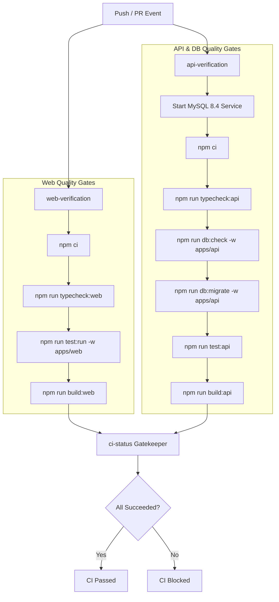

# HAZA AIOS — Epic 10N / Phase 5: Operational Automation, CI/CD & Release Governance

**Document ID:** `HAZA-AIOS-EPIC10N-PHASE5-001`  
**Repository:** `HAZA-AIOS/haza-aios`  
**Workspace:** `C:\HAZA-APPS\HAZA-AIOS`  
**Branch:** `feature/epic-10n-system-hardening`  
**Previous Accepted Development Commit:** `9738a1095cd23250360c95f03fafdaf634607d6b` (Phase 4)  
**Accepted Production Baseline:** `eb6c5d9df71c12a975b462418ae0d6fdf5a89113`  
**Current Phase:** Epic 10N — Phase 5 of 5  
**Authorized Scope:** `OPS-001` and `OPS-002` only.

---

## 1. Executive Summary

Phase 5 completes the development scope for **Epic 10N: System Hardening & Cross-Module Auditing**. Its purpose is to establish robust automated verification, continuous integration quality gates, and formal release governance before consolidated production deployment review.

Key deliverables achieved in Phase 5:
1. **OPS-001 (Automated GitHub Actions CI Pipeline):**
   - Implemented `.github/workflows/ci.yml` titled `HAZA AIOS — Continuous Integration`.
   - Structured into parallel verification jobs (`web-verification` and `api-verification`) with a consolidated gatekeeper (`ci-status`).
   - Configured ephemeral MySQL 8.4 service container in CI with automated health checks, non-production credentials, and strict loopback bindings.
   - Enforced 7 mandatory blocking quality gates: Web typecheck, Web tests, Web build, API typecheck, Database schema validation (`drizzle-kit check`), Database migrations (`npm run db:migrate`), API tests (unit & integration), and API build (`tsc`).
   - Least-privilege permissions (`contents: read`), zero secrets leakage, and concurrency controls (`cancel-in-progress: true`).
2. **OPS-002 (Release Tag Reconciliation & Governance):**
   - Reconciled repository tag inventory: confirmed that release tag for Epic 10M was missing.
   - Identified exact accepted Epic 10M production commit: `eb6c5d9df71c12a975b462418ae0d6fdf5a89113`.
   - Formulated authorized tagging command (`git tag -a v0.10.13-epic10m eb6c5d9df71c12a975b462418ae0d6fdf5a89113 -m "Release Epic 10M — Financial Management Enhancement & Direct Subroutes"`).
   - Formulated future Epic 10N release tag proposal (`v0.10.14-epic10n`) to be executed only after consolidated operator release authorization.
   - Strictly preserved release governance: **zero tags created or pushed during Phase 5**.
3. **Release Readiness & Governance Artifacts:**
   - Authored `docs/epic-10n/EPIC-10N-RELEASE-READINESS.md` consolidating verification evidence across all 5 phases.
   - Authored `docs/epic-10n/EPIC-10N-DEPLOYMENT-RUNBOOK.md` detailing the safe 6-stage production deployment sequence, migration backfill dry-runs, and multi-tier rollback procedures.
   - Updated `docs/epic-10n/EPIC-10N-AUDIT-MATRIX.md` and `docs/epic-10n/EPIC-10N-IMPLEMENTATION-PLAN.md`.

---

## 2. Preflight Repository & CI Audit Findings

Prior to making changes, an audit of existing repository automation and release artifacts was conducted:
1. **GitHub Workflows:** `.github/workflows/` previously contained only `.gitkeep`. No automated CI pipeline existed for pull request validation or branch verification.
2. **Package Manager & Scripts:**
   - Package manager: npm `11.4.2` with root `package-lock.json`.
   - Node.js runtime: Node.js 22 LTS (`v22.23.2` local).
   - Monorepo workspace configuration: `apps/*` (`apps/web`, `apps/api`) and `packages/*`.
3. **Database Tooling:**
   - ORM: Drizzle ORM (`drizzle-orm@^0.45.2`, `drizzle-kit@^0.31.10`).
   - Migration runner: `apps/api/src/database/scripts/migrate.ts` utilizing `mysql94-migrator.js` for MySQL 8.0/8.4/9.x dialect compatibility.
   - Schema check: `npm run db:check -w apps/api` (`drizzle-kit check --config drizzle.config.ts`).
4. **Railway Deployment Coupling Check:**
   - Inspected `apps/api/railway.toml` and documentation in `docs/stage-21/`.
   - Confirmed that Railway production services strictly track branch `main`.
   - Railway production does NOT track `feature/epic-10n-system-hardening`.
   - Pushing the feature branch to `origin` carries zero risk of triggering production deployments.
5. **Git Tag Inventory:**
   - Existing tags: `v0.1.0-alpha.1`, `v0.2.0-alpha.1`, `v0.3.0-alpha.1`, `v0.9.0-alpha.1`, `v0.9.0-alpha.2`.
   - Confirmed missing: No tag existed for Epic 10M (`eb6c5d9df71c12a975b462418ae0d6fdf5a89113`).

---

## 3. OPS-001 — GitHub Actions CI Pipeline Architecture

### 3.1 Pipeline Specification (`.github/workflows/ci.yml`)

The CI workflow implements two parallel verification jobs and one status gatekeeper:



### 3.2 Trigger Policy
- **Pushes:** Targeted to `main`, `develop`, and `feature/epic-10n-system-hardening`.
- **Pull Requests:** Targeted to `main` and `develop`.
- **Manual Execution:** `workflow_dispatch` enabled for ad-hoc validation.
- **Concurrency:** `cancel-in-progress: true` keyed by `${{ github.workflow }}-${{ github.ref }}` prevents redundant builds on rapid pushes.

### 3.3 Security & Least Privilege
- **Permissions:** `contents: read` at workflow level. Zero write permissions to repositories, packages, or deployments.
- **Credential Isolation:** Ephemeral test database runs on ephemeral runner container with localized credentials (`test_root_password`). Zero production secrets or keys are stored in GitHub Actions secrets or exposed in logs.
- **Trusted Actions:** Pinned to maintained standard actions (`actions/checkout@v4`, `actions/setup-node@v4`).

### 3.4 Ephemeral Database Isolation
The `api-verification` job provisions an isolated MySQL 8.4 service:
```yaml
services:
  mysql:
    image: mysql:8.4
    env:
      MYSQL_ROOT_PASSWORD: test_root_password
      MYSQL_DATABASE: haza_aios_integration_test
    ports:
      - 3306:3306
    options: --health-cmd="mysqladmin ping -ptest_root_password" --health-interval=10s --health-timeout=5s --health-retries=5
```
Because the host is `127.0.0.1` and database name is `haza_aios_integration_test`, this container strictly complies with `assertSafeDatabaseConfig` in `test-database-guard.ts`, allowing full execution of all 37 API test suites (unit + integration).

---

## 4. Test Coverage Matrix

| Subsystem | Suite / Command | Test Type | Runner / Env | Blocking Status |
| :--- | :--- | :---: | :---: | :---: |
| **Web Typecheck** | `npm run typecheck:web` | Static Type Analysis | Host (Node 22) | **BLOCKING** |
| **Web Tests** | `npm run test:run -w apps/web` | Unit, Component, Router | JSDOM / Vitest | **BLOCKING** |
| **Web Build** | `npm run build:web` | Production Compilation | Vite / Rollup | **BLOCKING** |
| **API Typecheck** | `npm run typecheck:api` | Static Type Analysis | Host (Node 22) | **BLOCKING** |
| **Schema Check** | `npm run db:check -w apps/api` | Schema Migration DDL Audit | Drizzle Kit | **BLOCKING** |
| **DB Migrations** | `npm run db:migrate -w apps/api` | Live Migration Execution | MySQL 8.4 Service | **BLOCKING** |
| **API Unit Tests** | `npm run test:api` (Unit) | Fast Unit Tests | Node / Vitest | **BLOCKING** |
| **API Integration** | `npm run test:api` (Integration) | End-to-End DB & RBAC | MySQL 8.4 Service | **BLOCKING** |
| **API Build** | `npm run build:api` | Production Compilation | TypeScript (`tsc`) | **BLOCKING** |

### Test Scope Breakdown
1. **Security (`SEC-001`–`SEC-004`):** Rate limiter sliding window, IP spoofing defense, proxy CIDR matching, authoritative actor enforcement.
2. **Data Integrity (`INT-001`–`INT-004`):** Admissions transactional rollback, student archival cascade, section transfer atomicity, sequence numbers.
3. **Database (`DB-001`–`DB-004`):** SQL-filtered rosters, input pre-validation, bounded batch retrieval, row-level locking on recurring billing.
4. **Frontend UX (`UX-001`, `UX-002`):** Canonical attendance routes, legacy redirects, synchronous in-flight submission locks.

---

## 5. OPS-002 — Release Tag Governance & Reconciliation

### 5.1 Existing Tag Inventory
```
v0.1.0-alpha.1  Release Epic 0 — Project Foundation
v0.2.0-alpha.1  release: HAZA AIOS design system
v0.3.0-alpha.1  release: HAZA AIOS marketing website
v0.9.0-alpha.1  Stage 19 Production Release: Password Recovery, Notifications, Metering, Workflows
v0.9.0-alpha.2  HAZA AIOS v0.9.0-alpha.2
```

### 5.2 Epic 10M Tag Reconciliation Specification
- **Production Commit:** `eb6c5d9df71c12a975b462418ae0d6fdf5a89113`
- **Commit Title:** `Merge feature/epic-10m-financial-management into develop: direct subroutes and tab synchronization`
- **Recommended Tag Name:** `v0.10.13-epic10m`
- **Rationale:** Aligns with semantic numbering following `v0.9.0-alpha.2` and marks the completion of the accepted Epic 10M production baseline.
- **Authorized Execution Command (for later execution):**
  ```bash
  git tag -a v0.10.13-epic10m eb6c5d9df71c12a975b462418ae0d6fdf5a89113 -m "Release Epic 10M — Financial Management Enhancement & Direct Subroutes"
  git push origin v0.10.13-epic10m
  ```

### 5.3 Epic 10N Future Tag Proposal
- **Recommended Tag Name:** `v0.10.14-epic10n`
- **Target SHA:** To be determined upon final squash/merge commit to `main` following full acceptance.
- **Preconditions Required Prior to Tagging:**
  1. Operator authorization of consolidated Epic 10N release.
  2. Successful completion of pre-migration backup and migration dry-run.
  3. Clean merge of `feature/epic-10n-system-hardening` into `develop` and `main`.
  4. Passing CI execution on `main`.

---

## 6. Monorepo Quality Gates Verification

All 7 required quality gates were executed locally and confirmed passing prior to Phase 5 completion:
- `npm run typecheck:web` -> 0 errors (Passed)
- `npm run build:web` -> 15.59s Vite build (Passed)
- `npm run test:run -w apps/web` -> 50 test files passed, 285 tests passed (Passed)
- `npm run typecheck:api` -> 0 errors (Passed)
- `npm run build:api` -> clean TypeScript build (Passed)
- `npm run test:api` -> 37 test files passed, 274 tests passed (Passed)
- `npm run db:check -w apps/api` -> "Everything's fine 🐶🔥" (Passed)
- YAML validation (`.github/workflows/ci.yml`): Verified valid syntax via `python -c "import yaml; yaml.safe_load(...)"`.

---

## 7. Mandatory Release Constraints

- **Zero Deployments:** Phase 5 is NOT deployed to Railway or Cloudflare.
- **Zero Merges:** No branch merges performed into `main` or `develop`.
- **Zero Migrations:** No migrations executed against production databases.
- **Zero Tags:** No release tags created or pushed.
- **Review Requirement:** Final release will be executed only after consolidated operator sign-off.
