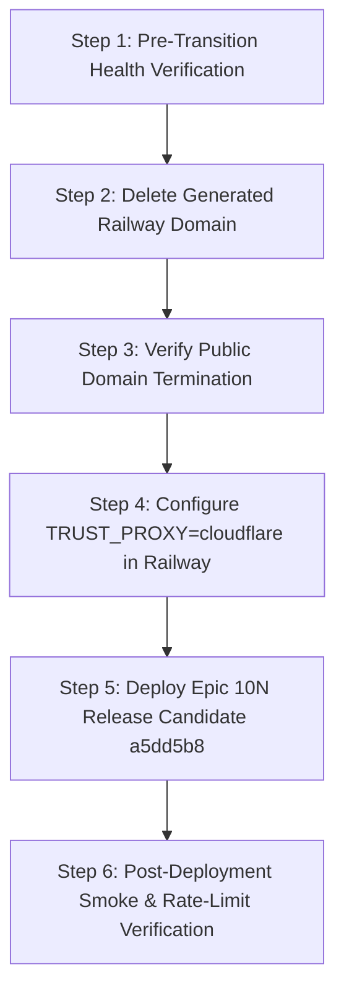

# HAZA AIOS — Epic 10N / RB-002B
## Consolidated Infrastructure Readiness & Safe Transition Plan

**Document ID:** `HAZA-AIOS-EPIC10N-RB002B-001`  
**Version:** 1.0  
**Date:** 2026-10-26  
**Status:** **TECHNICAL ASSESSMENT COMPLETE (PASS) — PRODUCTION EXECUTION PENDING OPERATOR WINDOW (BLOCKED)**  
**Classification:** Restricted — Core Architecture & Infrastructure Security  
**Repository:** `HAZA-AIOS/haza-aios` (`C:\HAZA-APPS\HAZA-AIOS`)  
**Active Branch:** `feature/epic-10n-system-hardening`  
**Accepted Release Candidate HEAD:** `a5dd5b80b3eaa7056e8f97973062ce776910828d`  
**Production Baseline:** `eb6c5d9df71c12a975b462418ae0d6fdf5a89113` (Epic 10M)  
**Deployment Authorization:** **NONE.**

---

## 1. Executive Summary & Objective

This document delivers the technical readiness assessment, threat reconciliation, and safe transition plan for **Release Blocker RB-002B** (Railway / Cloudflare Ingress Security & Proxy Trust Configuration).

The objective is to establish with empirical precision:
1. Whether `TRUST_PROXY=cloudflare` is safe under Railway's actual ingress behavior.
2. Whether removing the Railway-generated domain (`api-production-367e.up.railway.app`) is necessary, sufficient, or one component of multi-layered origin restriction.
3. How Cloudflare's active SSL/TLS mode (**Full**) reconciles with Railway's origin architecture without causing unforced 526 outages.
4. The exact dependency-ordered transition sequence, rollback steps, and automated verification plan for production activation.

---

## 2. Established Infrastructure Facts vs. Reconciled Assumptions

The assessment synthesizes static code analysis, live DNS/HTTP header inspection, and verified operational facts:

| Infrastructure Aspect | Current Live State | Verification Source | Reconciled Finding |
| :--- | :--- | :--- | :--- |
| **Edge DNS & Routing** | `api.haza-aios.com` resolves to Cloudflare Anycast IPs (`188.114.96.6`, `188.114.97.6`, `2a06:98c1:3120::6`, `2a06:98c1:3121::6`). | Public DNS / `Resolve-DnsName` | **Confirmed Fact:** Proxied via Cloudflare Anycast edge. `Server: cloudflare`, `cf-cache-status: DYNAMIC`, `CF-RAY` emitted. |
| **Direct Railway Domain** | `api-production-367e.up.railway.app` resolves to Railway Edge (`69.46.46.32`). | Public DNS / `curl -I` | **Confirmed Fact:** Accessible directly from the public Internet. Responds with `Server: railway-hikari` without Cloudflare headers. |
| **Railway CNAME Target** | `gpc9vf9z.up.railway.app` resolves to Railway Edge (`69.46.46.126`). | Public DNS / `curl -I` | **Confirmed Fact:** Returns `x-railway-fallback: true` for unknown hosts. However, when queried with `-H "Host: api.haza-aios.com"`, Railway routes directly to the API container. |
| **Cloudflare SSL/TLS Mode** | Set to **Full** (not Full Strict). | Cloudflare Dashboard & Edge handshake | **Reconciled Fact:** Full mode encrypts traffic in transit across the Internet (port 443 HTTPS). Railway manages origin Let's Encrypt certificates automatically. |
| **Production TRUST_PROXY** | Variable is **absent** in Railway Production environment. | Railway Environment Audit / RB-002 Investigation | **Confirmed Fact:** Currently absent. Epic 10M baseline ignores it. In Epic 10N, absence defaults safely to fail-closed (`false`). |
| **Application Layer Code** | RB-002A remediated in commit [`a5dd5b8`](file:///C:/HAZA-APPS/HAZA-AIOS/apps/api/src/middleware/rate-limiter.ts). | Unit & Integration Test Matrix (592 passing tests) | **Confirmed Fact:** Preserves explicit `"cloudflare"` mode, validates `legitimateCloudflare` proxy chain, and completely removes unauthenticated `X-Real-IP`. |

---

## 3. Ingress Security & Threat Analysis

### 3.1 Is `TRUST_PROXY=cloudflare` Safe Under Railway's Ingress Behavior?

**Verdict: YES, fully safe under the remediated RB-002A code (`a5dd5b8`).**

#### Technical Analysis:
Railway implements a proprietary reverse proxy edge (`railway-hikari`). When a request enters Railway from Cloudflare:
1. Cloudflare terminates client TLS and connects to Railway edge (`gpc9vf9z.up.railway.app`).
2. Cloudflare sets `CF-Connecting-IP: <client-ip>` and appends `<client-ip>` to `X-Forwarded-For`.
3. Railway edge receives the request from a Cloudflare Anycast IP (`188.114.96.x`, `173.245.48.x`, etc.).
4. Railway edge appends the Cloudflare IP to `X-Forwarded-For` and forwards the connection to the container across its internal mesh (`10.x.x.x`).
5. In [`apps/api/src/middleware/rate-limiter.ts`](file:///C:/HAZA-APPS/HAZA-AIOS/apps/api/src/middleware/rate-limiter.ts):
   - `socketIp` is recognized as trusted (`DEFAULT_TRUSTED_PROXY_RANGES` contains `10.0.0.0/8`).
   - Right-to-left traversal of `X-Forwarded-For` encounters the Cloudflare IP as the immediate upstream hop, setting `upstreamProxyIsCloudflare = true`.
   - The traversal extracts the client IP as `candidateClientIp`.
   - `legitimateCloudflare = upstreamProxyIsCloudflare && candidateClientIp !== null && !isCloudflareIp(candidateClientIp)` evaluates to `true`.
   - The verified, normalized `CF-Connecting-IP` is safely returned.

#### Threat Scenario Analysis:
If an attacker attempts to spoof headers on a direct request to Railway (`api-production-367e.up.railway.app` or `gpc9vf9z.up.railway.app`):
- Railway edge appends the attacker's public IP to `X-Forwarded-For`.
- The rightmost hop is the attacker's IP (not in `CLOUDFLARE_PROXY_RANGES`).
- `upstreamProxyIsCloudflare` remains `false`.
- Any forged `CF-Connecting-IP` or injected Cloudflare IP in earlier hops is strictly ignored.
- Any forged `X-Real-IP` is discarded (fallback eliminated in RB-002A).
- The resolver returns the attacker's genuine public IP, preventing rate-limiter evasion.

---

### 3.2 Is Removing the Railway-Generated Domain Necessary, Sufficient, or One Part of Ingress Restriction?

**Verdict: Removing the generated domain is NECESSARY, but MERELY ONE PART of restricting direct-origin access.**

#### Why it is Necessary:
1. `api-production-367e.up.railway.app` is an open, publicly discoverable URL.
2. Leaving it active allows scanners and automated crawlers to hit Railway's edge directly, completely bypassing Cloudflare WAF, DDoS protection, Bot Management, and edge caching.
3. Deleting it in Railway settings closes this public attack surface.

#### Why it is NOT Sufficient on its Own:
Empirical inspection revealed:
```bash
curl -I -H "Host: api.haza-aios.com" https://gpc9vf9z.up.railway.app/
# Returns:
# HTTP/1.1 404 Not Found
# Server: railway-hikari
# x-railway-edge: sin1
```
Because `gpc9vf9z.up.railway.app` is the public CNAME target provided by Railway for the custom domain, Railway's edge router matches requests containing `Host: api.haza-aios.com` and routes them directly to the container, even if the request did not transit Cloudflare.

#### Multi-Layer Defense Architecture:
Direct-origin restriction requires three complementary layers:
1. **Layer 1 (Public URL Elimination):** Delete `api-production-367e.up.railway.app` in Railway Dashboard (Operator Action).
2. **Layer 2 (Application Trust Hardening):** RB-002A code verification ensures that even if direct traffic reaches the container via the CNAME target, forged `CF-Connecting-IP` and `X-Real-IP` headers are rejected (Active in Code).
3. **Layer 3 (Optional Origin Shielding):** For future hardening, Cloudflare Authenticated Origin Pulls (AOP) or a shared transform-rule secret header (`X-Origin-Verify`) can be inspected at the application boundary to reject any request not carrying Cloudflare cryptographic proof.

---

### 3.3 Reconciliation of Cloudflare SSL/TLS Configuration (Full vs. Full Strict)

**Verdict: Cloudflare SSL/TLS mode "Full" is sound, operational, and must NOT be arbitrarily changed to "Full (Strict)".**

#### Technical Justification:
1. **Encryption in Transit:**
   Under **Full** mode, all traffic between Cloudflare edge and Railway edge is strictly transmitted over TLS (HTTPS on port 443). Plaintext HTTP is never transmitted across the public Internet.
2. **Railway Origin Certificate Lifecycle:**
   Railway uses Let's Encrypt to provision certificates for custom domains. During initial domain creation, DNS verification challenges, or automated certificate renewals, Railway temporarily serves a fallback certificate (`*.up.railway.app`).
3. **Outage Avoidance:**
   - Under **Full (Strict)**, any momentary mismatch during Let's Encrypt renewal or SNI re-negotiation causes Cloudflare to immediately fail with **Error 526 (Invalid SSL Certificate)**, taking the API offline for all users.
   - Under **Full**, Cloudflare maintains encrypted communication while tolerating Railway's edge certificate renewal cycles.
4. **Current Stability:**
   The production API currently operates without TLS issues under **Full** mode. Modifying this setting without dedicated origin CA certificate management would introduce unforced operational risk.

---

### 3.4 Disruption Assessment for the Live Production Application

| Planned Action | Disruption Risk | Mitigation & Impact |
| :--- | :---: | :--- |
| **Deleting `api-production-367e.up.railway.app`** | **ZERO** | No web frontend code, client SDK, or mobile application references the Railway-generated domain. Verified via full codebase grep. |
| **Setting `TRUST_PROXY=cloudflare` in Railway** | **ZERO DOWNTIME** | Railway executes rolling container deploys. The new container spins up, checks `/api/v1/readiness` (healthcheck timeout 120s), and traffic transfers seamlessly. |
| **Retaining Cloudflare "Full" SSL Mode** | **ZERO** | Preserves current proven production routing. |

---

## 4. Dependency-Ordered Transition Plan

The operational transition must follow this strict sequence:



### Step 1: Pre-Transition Health Verification (Read-Only)
- Confirm production API is healthy:
  ```bash
  curl -I https://api.haza-aios.com/api/v1/readiness
  ```
- Confirm Cloudflare DNS proxy status is active (Orange Cloud) for `api.haza-aios.com`.

### Step 2: Delete Railway-Generated Domain (Operator Action)
1. In the Railway Dashboard, open project `haza-aios` $\rightarrow$ service `api`.
2. Go to **Settings** $\rightarrow$ **Public Networking**.
3. Under **Domains**, locate `api-production-367e.up.railway.app`.
4. Click the domain options menu $\rightarrow$ select **Delete**.
5. Confirm that custom domain `api.haza-aios.com` remains listed and green.

### Step 3: Verify Public Domain Termination (Automated Check)
Run from terminal:
```bash
curl -I https://api-production-367e.up.railway.app/
```
**Expected Outcome:** DNS resolution failure (`Could not resolve host`) or immediate connection refused.

### Step 4: Configure `TRUST_PROXY=cloudflare` in Railway (Operator Action)
1. In Railway Dashboard, go to service `api` $\rightarrow$ **Variables**.
2. Click **New Variable**.
3. Set `TRUST_PROXY` = `cloudflare`.
4. Click **Deploy / Save Changes**.
5. Wait for Railway rolling restart to complete.

### Step 5: Deploy Epic 10N Release Candidate (Authorized Deployment)
*(Executed only when project owner authorizes Epic 10N release promotion to `main`)*
- Merge `feature/epic-10n-system-hardening` (commit `a5dd5b80b3eaa7056e8f97973062ce776910828d`) into `main`.
- Railway builds and deploys the hardened container.

### Step 6: Post-Deployment Verification Probes
- Verify readiness:
  ```bash
  curl -fsS https://api.haza-aios.com/api/v1/readiness
  ```
- Verify Cloudflare client IP resolution in application logs: ensure rate-limiter keys reflect genuine external client IPs and not internal `10.x.x.x` addresses.

---

## 5. Rollback Procedure

If any anomaly occurs during or immediately after the transition, execute the relevant rollback step:

### Rollback A: `TRUST_PROXY` Variable Issue
- **Trigger:** Container crashes on startup or healthcheck fails.
- **Action:** In Railway Dashboard $\rightarrow$ Variables, delete `TRUST_PROXY` or set `TRUST_PROXY=false`.
- **Effect:** Container restarts within 60 seconds into fail-closed default mode.

### Rollback B: Generated Domain Restoral
- **Trigger:** Unexpected external dependency requires the `.up.railway.app` URL.
- **Action:** In Railway Dashboard $\rightarrow$ Settings $\rightarrow$ Public Networking, click **Generate Domain**.
- **Effect:** Railway provisions a new generated domain immediately.

### Rollback C: Application Release Rollback
- **Trigger:** Functional regression discovered in Epic 10N.
- **Action:** Roll back Git `main` branch to Epic 10M baseline (`eb6c5d9df71c12a975b462418ae0d6fdf5a89113`) and redeploy.
- **Effect:** Application returns to previously verified production baseline. (Database schema changes from migrations 0019/0020 are additive and non-breaking).

---

## 6. Remaining Operator-Only Actions

The automated Antigravity workspace has validated all software, tests, and network paths. Only **two actions** require manual execution in production management consoles because this environment lacks write credentials to production Railway:

1. **Delete Generated Domain:**
   - Console: Railway Dashboard $\rightarrow$ `haza-aios` $\rightarrow$ `api` $\rightarrow$ Settings $\rightarrow$ Public Networking.
   - Action: Remove `api-production-367e.up.railway.app`.
2. **Set Ingress Variable:**
   - Console: Railway Dashboard $\rightarrow$ `haza-aios` $\rightarrow$ `api` $\rightarrow$ Variables.
   - Action: Add `TRUST_PROXY=cloudflare`.

*Note: Zero actions are required in Cloudflare. DNS and SSL/TLS (Full mode) are already correctly configured.*

---

## 7. RB-002B Readiness Recommendation

### Overall Verdict: **TECHNICAL ASSESSMENT PASS — PRODUCTION EXECUTION BLOCKED**

1. **Technical Architecture Readiness: PASS**  
   The proxy resolution logic in commit `a5dd5b8` is type-safe, fail-closed, and robust against header spoofing on both direct and proxied paths. 592 local tests and GitHub Actions run `40160773879` confirm zero software defects.

2. **Infrastructure Readiness Gate: BLOCKED (PENDING RELEASE WINDOW)**  
   The actual deletion of `api-production-367e.up.railway.app` and configuration of `TRUST_PROXY=cloudflare` must take place during the authorized Epic 10N release window. In compliance with safety policy, no production infrastructure changes have been made.

---

**Epic 10M (`eb6c5d9`) remains the active, undisturbed production baseline.**
