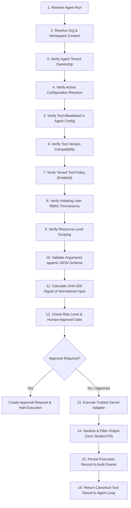

# HAZA-AIOS — EPIC 16
## Tool Registry & Execution Gateway Architecture

### 1. Overview
The Agent Tool Execution Gateway is the central enforcement point for all interactions between AI agents and HAZA-AIOS domain services. It ensures that agents can never bypass tenant isolation, permission models, or domain rules.

---

### 2. The 16-Step Execution Pipeline
Every tool call initiated by an AI agent during runtime execution traverses a 16-step validation, authorization, and execution pipeline:

#### Step Details:
1. **Resolve Authenticated Agent Run:** Ensures `runId` exists, belongs to the organization, and is in an executable state (`running`).
2. **Resolve Tenant Context:** Extracts `organizationId` and `workspaceId` from the run context.
3. **Verify Agent Ownership:** Ensures `agentId` is registered and belongs to the specified organization.
4. **Verify Revision Pinning:** Extracts pinned `configurationRevisionId` from the run, preventing drift from mid-run agent modifications.
5. **Verify Explicit Allowlist:** Checks `toolsAllowlist` in the agent's pinned revision. If the requested `toolKey` is not present, invocation is rejected immediately with `TOOL_UNAUTHORIZED`.
6. **Verify Version Compatibility:** Resolves requested version against available versions and deprecation status.
7. **Verify Tenant Policy:** Inspects `ai_agent_tool_tenant_policies`. If disabled by tenant administrators, rejected with `TENANT_POLICY_DISABLED`.
8. **Verify Requester RBAC Permissions:** Validates that the initiating user possesses all required permissions specified by the tool definition (e.g. `education.academic.read`, `education.lesson_plan.create`).
9. **Verify Resource Scoping:** Enforces that all IDs supplied in parameters (such as `gradeId`, `subjectId`, `planId`) belong strictly to the tenant workspace.
10. **Validate Input Schema:** Validates input parameters against the tool's JSON Schema. Required fields, types, string length bounds, and formats are strictly enforced.
11. **Calculate SHA-256 Digest:** Computes deterministic SHA-256 hash of canonicalized JSON arguments for audit integrity, idempotency, and tamper detection.
12. **Risk & Approval Evaluation:** Determines whether human approval is required based on tool risk level (`high`), tool approval policy (`always`, `on_risk`), or tenant policy overrides.
13. **Adapter Execution:** Dispatches to trusted, server-side TypeScript domain adapters (`SisService`, `AcademicLessonPlanRepository`). Direct SQL and arbitrary shell/network calls are prohibited.
14. **Output Sanitization:** Filters output to ensure compliance with privacy boundaries (zero student PII access or exposure; strictly pedagogical and administrative data).
15. **Execution Persistence & Auditing:** Writes complete execution history to `ai_agent_tool_executions`, including input/output snapshots, latency (`durationMs`), status, and correlation IDs. Emits `tool_completed` or `tool_failed` events.
16. **Canonical Result:** Formats output into a standard structured result object for model ingestion.

---

### 3. Registry & Versioning Design
- **Tool Key Immutability:** Tools are referenced by hierarchical keys (e.g., `education.academic_structure.read`, `education.lesson_plans.publish`).
- **Semantic Versioning:** Each tool has a semantic version (e.g., `1.0.0`). Agent revisions pin explicit versions. Updating a tool version never silently expands capabilities of existing agents.
- **Trusted Implementations:** Tool definitions stored in `ai_agent_tools` only map metadata, schemas, and configurations. The executable logic resides exclusively in compiled server code (`trusted-tool-registry.ts`).

---

### 4. Tenant Policy Management
Tenant administrators maintain sovereign control over tools in their workspace:
- **Tenant Enable/Disable:** Tenants can disable any tool organization-wide or workspace-wide.
- **Approval Policy Overrides:** Tenants can heighten approval policies (e.g., enforcing approval for medium-risk tools).
- **Agent Allowlisting:** Tenants can restrict specific tools to designated agent instances.
- **Rate Limit Customization:** Custom per-minute rate limits can be applied to protect domain service capacity.
