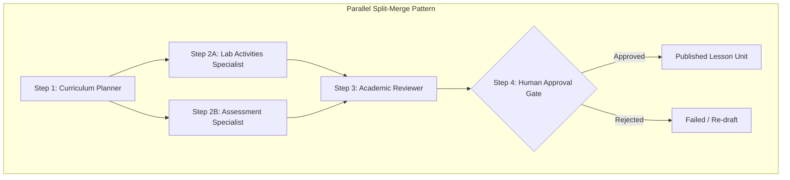

# HAZA-AIOS — EPIC 19 WORKFLOW ARCHITECTURE
## Multi-Agent DAG Coordination & Shared Context Engine

**Document ID:** `HAZA-EPIC-19-ARCH-001`  
**Target Release:** `v0.19.0-epic19`  
**Status:** `APPROVED ARCHITECTURE`  
**Author:** Antigravity AI Systems Architect  
**Date:** 2026-11-03  

---

## 1. Architectural Philosophy: The Execution Hierarchy

Orchestration in HAZA-AIOS follows a strict hierarchical model:

```
Organization (Tenant Boundary)
  └── Workspace (Project / School Domain)
        └── Agent Team (Collaborative Roster of Specialized Agents)
              └── Workflow Definition (Versioned DAG Schema & Step Graph)
                    └── Workflow Run (Durable Execution Instance)
                          └── Workflow Step Run (Individual Step Dispatched to Agent)
                                └── Agent Run (Runtime Execution with Tool/Provider Access)
                                      └── Artifacts & Events (Outputs, Provenance, Timeline)
```

No workflow may cross organization boundaries. Agents can only execute within the permissions and tool policies assigned by tenant administrators.

---

## 2. DAG Validation & Kahn's Topological Sort Algorithm

Workflow definitions represent Directed Acyclic Graphs (DAGs) of execution steps. Each step defines:
- `stepKey`: Unique identifier within the workflow.
- `assignedRole`: Role required for execution (`planner`, `specialist`, `reviewer`, `supervisor`).
- `dependsOnStepKeys`: Array of step keys that must complete before this step can run.
- `requiresApproval`: Boolean gate requiring explicit human authorization.
- `outputKey`: Name under which step output is stored in shared workflow context.

### Topological Sort & Cycle Detection

The validation engine utilizes Kahn's algorithm:
1. Compute in-degree (number of upstream incoming edges) for every step.
2. Initialize queue with all steps having in-degree 0 (root steps).
3. Process nodes iteratively, decrementing in-degree of downstream dependent steps.
4. If total resolved steps is less than total steps, a **cycle exists** and validation fails with descriptive error:
   `Cycle detected involving steps: [step_a, step_b, ...]`



---

## 3. Orchestration Coordinator & Dispatch Lifecycle

When a workflow run starts:
1. Initial run record is created with status `queued` and transitioned to `running`.
2. Initial inputs are placed into `sharedContext.initialInput`.
3. `dispatchRunnableSteps` identifies all steps whose dependencies are 100% satisfied.
4. If a step has `requiresApproval: true`, it pauses in status `waiting_approval`, and the workflow enters `waiting_approval`.
5. For standard steps, the coordinator:
   - Resolves the assigned agent (via explicit ID, team role mapping, or active agent roster).
   - Assembles upstream context from `run.sharedContext` mapped by `dependsOnStepKeys`.
   - Dispatches through `AgentRuntimeService.createRun` and triggers worker execution via `claimAndExecute`.
   - Stores structured output in `sharedContext[step.outputKey]`.
   - Records an immutable `AgentWorkflowArtifactRecord` with provenance metadata.
   - Recursively evaluates downstream steps until all steps complete.

---

## 4. Shared Context Engine & Prompt Injection Isolation

To prevent prompt injection or untrusted data corruption between agents:
- Upstream outputs are passed as structured JSON inside an isolated `upstreamOutputs` envelope.
- Agent system prompts clearly delineate task instructions from user-provided context.
- All artifact records store complete provenance: `producerAgentId`, `stepKey`, `workflowRunId`, and UTC timestamp.

