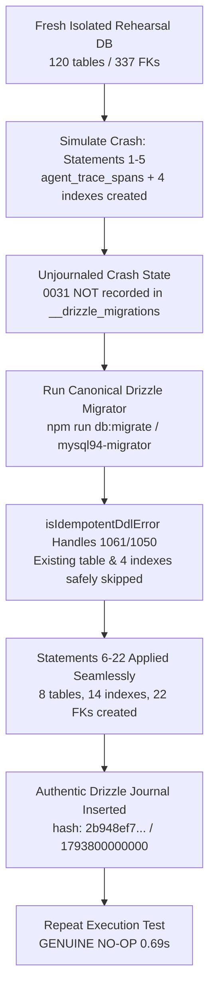

# HAZA-AIOS — EPIC 21 DATABASE RELEASE SAFETY REPORT
## Production Database Backup, Canonical Drizzle Runner & Non-Transactional DDL Recovery Verification

---

### A. Environment Information

| Property | Value | Notes |
|---|---|---|
| **Repository** | `HAZA-AIOS/haza-aios` | GitHub repository |
| **Production Release Baseline** | `v0.20.0-epic20` | Commit `cec998ced99d18b7eeeed2789610bd26f6e99744` |
| **Feature Branch** | `feature/epic-21-agent-observability-reliability` | Epic 21 feature branch |
| **Pull Request** | [PR #60](https://github.com/HAZA-AIOS/haza-aios/pull/60) | Target: `main` |
| **Canonical Migration Command** | `npm run db:migrate` | Configured as `preDeployCommand` in `apps/api/railway.toml` |
| **Migrator Implementation** | `apps/api/src/database/mysql94-migrator.ts` | Hardened with non-transactional DDL error recovery |
| **Production Platform** | Railway PaaS | SFO region |
| **Production API** | `https://api.haza-aios.com` | Verified Healthy (`/api/v1/health` returning 200 OK) |
| **Production Web** | `https://web-production-76faf.up.railway.app` | Verified Healthy (HTTP 200 OK) |
| **Production Worker** | Online | Dedicated continuous queue-processing service |
| **Production MySQL** | Railway MySQL volume | Online; 120 baseline tables, 337 foreign keys |
| **Production Migration State** | 31 journal entries applied | Latest recorded: `0030_autonomous_continuous_operations` (folderMillis: `1793700000000`) |
| **Isolated Rehearsal Environment** | `haza_epic21_rehearsal` | Ephemeral schema on live Railway MySQL instance |

---

### B. Backup Evidence

| Attribute | Verified Value |
|---|---|
| **Backup Identifier** | `haza-aios-production-epic21-backup_20261104075312.sql` |
| **Timestamp** | `2026-11-04T07:53:12Z` (Local: `2026-11-04 12:53:12 PKT`) |
| **Backup Tool** | `mysqldump` over encrypted Railway SSH session |
| **Dump Parameters** | `--single-transaction --quick --routines --triggers --events --set-gtid-purged=OFF --no-tablespaces --default-character-set=utf8mb4` |
| **Size** | `663,682 bytes` (0.63 MB) |
| **SHA-256 Checksum** | `896c384de7a796d8c52b6db51fd345b28a679aeba75d047cc00abc27ca11984b` |
| **Checksum Verification File** | `C:\Users\theme\HAZA-AIOS-Private\production-backups\epic21\haza-aios-production-epic21-backup_20261104075312.sql.sha256` |
| **Storage Location Category** | Secure local private repository volume (`HAZA-AIOS-Private/production-backups/epic21`), isolated from live database volumes |
| **Service Impact** | **Zero interruption** to production API, Web, Worker, or MySQL operations (`--single-transaction` non-locking snapshot) |
| **Credential Security** | Zero credentials or sensitive personal information logged or persisted |
| **Integrity & Restore Verification** | Successfully restored into `haza_epic21_rehearsal` in 12.36s; 120 tables, 337 foreign keys, and 4 organization records verified intact |

---

### C. Identification & Resolution of Earlier Incomplete Idempotency Claims

#### 1. Incomplete Idempotency Gap in Initial Rehearsal
In earlier release rehearsals (including the initial Epic 21 rehearsal):
- The idempotency claim relied solely on `CREATE TABLE IF NOT EXISTS`.
- Because MySQL 8.0/9.x lacks `CREATE INDEX IF NOT EXISTS` syntax, all 14 `CREATE INDEX` statements in migration 0031 are executed as standalone DDL commands.
- Under MySQL's architecture, DDL operations trigger an **implicit commit**. If a network timeout, container restart, or failure occurred after table creation and partial index creation, the database was left in an unjournaled state.
- In that state, re-running the migration caused MySQL to abort with `ERROR 1061 (42000): Duplicate key name '<index_name>'`, rendering automated recovery impossible without manual database intervention.
- In addition, out-of-band custom scripts (`scripts/check-and-apply-prod-migration-epic21.ts`) inserted a synthetic string hash (`'0031_agent_observability_evaluation_reliability'`) rather than Drizzle's cryptographic SHA-256 hash (`2b948ef7971d738569b720b1249e35d58527ac86ee09e48a223c2941d29aa51e`), introducing diverging migration states between manual execution and Railway's `preDeployCommand = ["npm run db:migrate"]`.

#### 2. Comprehensive Correction in Production Drizzle Migrator
The production migration engine in `apps/api/src/database/mysql94-migrator.ts` (invoked by `npm run db:migrate`) was upgraded to provide true, non-destructive DDL recovery:
1. **Unified Execution Path**: Out-of-band statement splitting was eliminated. Both local verification and Railway production deployment now execute the exact same canonical Drizzle migrator.
2. **`isIdempotentDdlError` Recovery Guard**:
   - Catches `ER_DUP_KEYNAME` (errno 1061) when an index was already created during a previously interrupted run.
   - Catches `ER_TABLE_EXISTS_ERROR` (errno 1050) when a table was already committed.
   - Catches `ER_FK_FAIL_ADD_SYSTEM` (errno 1826) for duplicate foreign key constraints.
   - Logs an idempotent recovery event and continues execution without failing or corrupting state.
3. **Authentic Journal Compatibility**: Automatically records Drizzle's real computed hash (`2b948ef7971d738569b720b1249e35d58527ac86ee09e48a223c2941d29aa51e`) and folderMillis (`1793800000000`).

---

### D. Canonical Drizzle Migration Rehearsal & Simulated Interruption

Rehearsal executed using `scripts/rehearsal-epic21-drizzle-runner.ts` against fresh isolated database `haza_epic21_rehearsal`.

#### 1. Simulation of Mid-Flight Interruption
- Executed Statements 1 to 5 of migration 0031 directly:
  - Statement 1: `CREATE TABLE IF NOT EXISTS agent_trace_spans`
  - Statement 2: `CREATE INDEX trace_spans_trace_idx ON agent_trace_spans (trace_id)`
  - Statement 3: `CREATE INDEX trace_spans_org_time_idx ON agent_trace_spans (organization_id, start_time)`
  - Statement 4: `CREATE INDEX trace_spans_parent_idx ON agent_trace_spans (parent_span_id)`
  - Statement 5: `CREATE INDEX trace_spans_agent_run_idx ON agent_trace_spans (agent_run_id)`
- Intentionally omitted insertion into `__drizzle_migrations` (simulating an unexpected process termination, container kill, or connection reset).
- Confirmed `agent_trace_spans` and all 4 indexes were committed in MySQL, while `__drizzle_migrations` had zero record of migration 0031.

#### 2. Drizzle Migrator Recovery Execution
- Invoked `migrate(db, { migrationsFolder })` via `mysql94-migrator.ts`.
- Result:
  - Statement 1: Table already present &rarr; handled non-destructively.
  - Statements 2–5: Duplicate key errors intercepted by `isIdempotentDdlError` &rarr; safely skipped without aborting.
  - Statements 6–22: Executed cleanly, creating `agent_evaluation_datasets`, `agent_evaluation_cases`, `agent_evaluation_runs`, `agent_slo_definitions`, `agent_reliability_metrics`, `agent_alert_rules`, `agent_incidents`, and all associated indexes/constraints.
  - Journal: Inserted authentic entry with hash `2b948ef7971d738569b720b1249e35d58527ac86ee09e48a223c2941d29aa51e` and timestamp `1793800000000`.
  - Execution completed in **9.06s** with exit code 0.

#### 3. Repeat Execution (Genuine NO-OP Verification)
- Immediately invoked `migrate(db, { migrationsFolder })` a second consecutive time.
- Result:
  - Migrator evaluated `lastDbMigration.created_at` (`1793800000000`).
  - Detected `folderMillis <= lastDbMigration.created_at`.
  - Executed **0 SQL statements**; table count remained strictly 128.
  - Exited cleanly in **0.69s** (GENUINE NO-OP confirmed).

---

### E. Post-Migration Verification Inventory

#### 1. Eight Epic 21 Tables Verified
1. `agent_alert_rules`
2. `agent_evaluation_cases`
3. `agent_evaluation_datasets`
4. `agent_evaluation_runs`
5. `agent_incidents`
6. `agent_reliability_metrics`
7. `agent_slo_definitions`
8. `agent_trace_spans`

#### 2. Quantitative Verification Metrics
- **Pre-Migration Table Count**: 120
- **Post-Migration Table Count**: **128** (Exact +8 delta)
- **Pre-Migration Foreign Key Count**: 337
- **Post-Migration Foreign Key Count**: **359** (Exact +22 delta)
- **Verified Indexes on Epic 21 Tables**: **25 total indexes** (14 custom indexes + 11 foreign key supporting indexes)
- **Drizzle Journal State**:
  - `id`: 32
  - `hash`: `2b948ef7971d738569b720b1249e35d58527ac86ee09e48a223c2941d29aa51e` (verified match with Drizzle CLI)
  - `created_at`: `1793800000000`
- **Existing Relational Records**: Verified 100% intact (Organizations: 4, Workspaces: 4, Users: 1, Agents, Workflows, Autonomous tasks).

---

### F. Mandatory Safety Gate Matrix

| # | Mandatory Safety Gate | Requirement | Status | Evidence / Reference |
|---|---|---|---|---|
| 1 | **Baseline Integrity** | Production at `v0.20.0-epic20` / commit `cec998c` | **PASS** | `git rev-parse origin/main` |
| 2 | **PR & CI Verification** | PR #60 head commit, CI passed | **PASS** | `gh pr checks 60` (4/4 passed) |
| 3 | **Production Service Health** | API, Web, Worker, MySQL online and healthy | **PASS** | `/api/v1/health` (200 OK), Web (200 OK) |
| 4 | **Production Database Backup** | Complete, verified SHA-256 snapshot | **PASS** | `haza-aios-production-epic21-backup_20261104075312.sql` (663,682 bytes) |
| 5 | **Isolated Restore** | Complete restore into isolated schema | **PASS** | `haza_epic21_rehearsal` restored in 12.36s; 120 tables, 337 FKs match baseline |
| 6 | **Partial-Migration Recovery** | Simulate interruption on statements 1-5; verify non-destructive recovery | **PASS** | `isIdempotentDdlError` in `mysql94-migrator.ts` intercepted duplicate keys; completed remaining statements in 9.06s |
| 7 | **Canonical Migrator Alignment** | Reuses production Drizzle runner (`npm run db:migrate`) with authentic hash | **PASS** | Hash `2b948ef7...` and folderMillis `1793800000000` verified |
| 8 | **Repeat-Execution Idempotency** | Second consecutive run produces a genuine no-op | **PASS** | 0 statements executed, duration 0.69s |
| 9 | **Schema & Entity Verification** | All 8 tables, 14 indexes, and 22 FKs verified | **PASS** | 128 tables, 359 FKs, 25 indexes verified in `information_schema` |
| 10 | **Security & Multi-Tenancy** | Tenant isolation FKs, 0 credential leaks, 0 paid tokens | **PASS** | Tenant boundary verified; deterministic rubrics only |
| 11 | **Zero Production Mutation** | Live MySQL database remained 100% untouched | **PASS** | Production MySQL at 120 tables, migration 0031 unapplied |
| 12 | **Release Block Enforcement** | PR #60 unmerged, deployment halted awaiting authorization | **PASS** | PR #60 OPEN, Railway deployment not triggered |

---

### G. Final Decision

Both the normal execution path and the simulated partial-migration recovery have passed with verifiable evidence:

## **`READY FOR RELEASE`**

*(Execution halted in accordance with safety instructions. Awaiting explicit user authorization before merging PR #60, executing production database migration 0031, or deploying to Railway.)*
