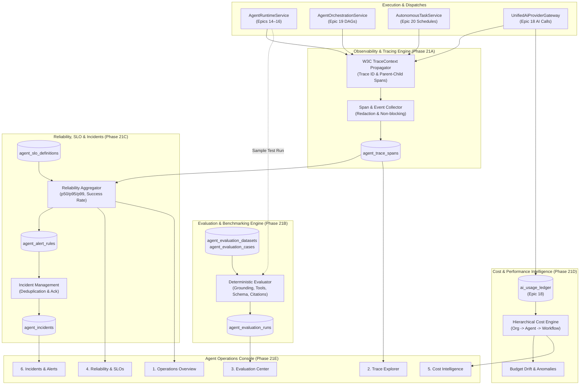

# HAZA-AIOS — EPIC 21 IMPLEMENTATION PLAN
## Agent Operations Observability, Evaluation & Reliability

**Repository:** HAZA-AIOS/haza-aios  
**Baseline Release:** v0.20.0-epic20  
**Target Release:** v0.21.0-epic21  
**Feature Branch:** `feature/epic-21-agent-observability-reliability`  
**Deploy Platform:** Railway (API, Web, Background Worker, MySQL)

---

## 1. Executive Purpose & Strategic Mandate

Epic 21 introduces enterprise-grade observability, continuous evaluation, SLO tracking, cost intelligence, and incident management into the HAZA-AIOS agent platform. 

As agents in HAZA-AIOS operate across multi-step DAG workflows (Epic 19) and autonomous continuous schedules (Epic 20), operators and school administrators require:
1. Complete visibility into distributed execution paths across nested agent calls and tool invocations.
2. Objective, repeatable, deterministic evaluation benchmarking to catch agent regression before production rollout.
3. Quantifiable reliability Service Level Objectives (SLOs) and automated incident management.
4. Granular, non-duplicated AI spending attribution per tenant, agent, and workflow.
5. A unified Operations Intelligence console providing real-time telemetry, trace inspection, evaluation runs, and alert resolution.

---

## 2. Core Architecture & Execution Strategy

The architecture adheres to core platform constraints:
- **Zero Second Runtime:** All telemetry, spans, evaluations, and metrics hook directly into existing `AgentRuntimeService`, `AgentOrchestrationService`, `AutonomousTaskService`, and `UnifiedAiProviderGateway`.
- **Zero Paid AI Evaluation:** Benchmark scoring uses deterministic heuristic and schema evaluation rules without consuming paid LLM tokens.
- **Fail-Closed Security & Deep Secret Redaction:** Telemetry and exported traces strictly redact API credentials, bearer tokens, and private prompts.
- **Multi-Tenant Boundary:** Every observability table, trace span, evaluation dataset, SLO definition, and incident is isolated by `organization_id` with foreign key cascades and composite indexes.

---

## 3. Implementation Phases (21A–21F)

### Phase 21A: Observability Foundation
- W3C `traceparent` and `x-correlation-id` distributed context propagation.
- Parent-child span hierarchy tracking workflow step dispatches, agent executions, tool calls, and model invocations.
- Structured JSON logging with tenant isolation and automated redaction (`sk-...`, passwords, access tokens).
- Non-blocking span ingestion preventing latency degradation.

### Phase 21B: Agent Evaluation Engine
- Versioned evaluation datasets and fictional benchmark test cases (Demo Academy scenarios).
- Deterministic scoring:
  - Grounding & citation score (verifies facts against retrieved context).
  - Tool invocation accuracy (validates correct tools called with expected schema parameters).
  - Schema & format compliance (structural JSON validation).
- Baseline run comparison and automated regression detection.

### Phase 21C: Reliability and SLO Engine
- Precise SLO definitions:
  - Availability & Success Rate (Target: 99.5%).
  - Latency percentiles: p50, p95, p99 (Target: p95 < 2500ms).
  - Queue backlog & worker lease health.
- Alert rules with configurable evaluation windows (15m, 1h, 24h) and severity (`info`, `warning`, `critical`).
- Incident lifecycle management: deduplication, automatic incident creation, acknowledgement, mitigation, and resolution.

### Phase 21D: Cost and Performance Intelligence
- Direct aggregation of Epic 18 `ai_usage_ledger`.
- Multi-dimensional attribution:
  - By Organization / Workspace.
  - By Agent Definition.
  - By Multi-Agent Workflow DAG.
  - By Model Provider (OpenAI, Anthropic, Mock).
- Cost anomaly detection and budget consumption velocity.

### Phase 21E: Operations Intelligence Console
- 6 dedicated operational views in `@haza-aios/ui` dark theme:
  1. *Operations Overview*: High-level telemetry, health score, active incidents, SLO burn rate.
  2. *Distributed Trace Explorer*: Interactive span waterfall visualization, latency breakdown, and error root-cause inspection.
  3. *Agent Evaluation Center*: Dataset manager, benchmark execution launcher, regression diff viewer.
  4. *Reliability & SLO Monitoring*: Real-time SLO status cards, error budget burn rates, latency percentiles.
  5. *AI Cost Intelligence*: Spending trends, token usage breakdown, model efficiency comparisons.
  6. *Incident & Alert Management*: Incident resolution queue, acknowledgement, and audit logging.

### Phase 21F: Automated Verification & Acceptance
- Automated test suite in `apps/api/tests/epic21-observability-reliability.test.ts`.
- Full validation of all trace propagation, evaluation benchmarking, SLO evaluations, alert deduplication, and cost reconciliation logic.

