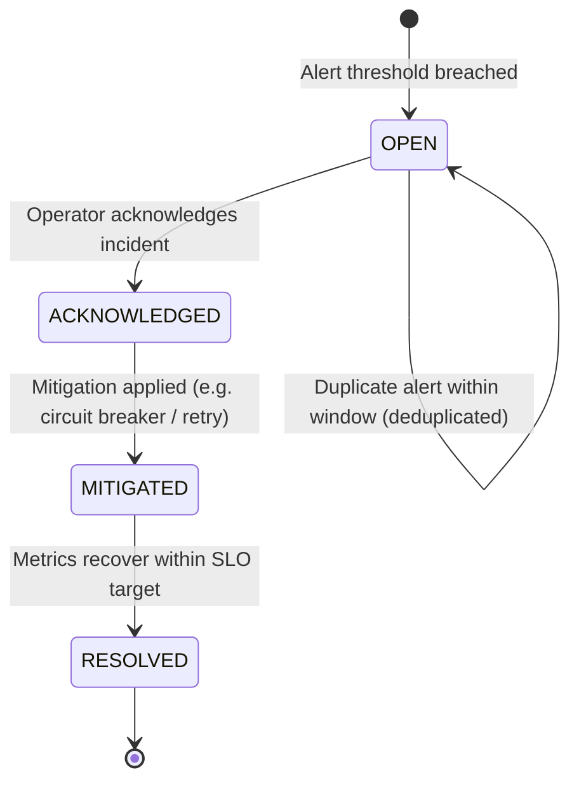

# HAZA-AIOS — EPIC 21: RELIABILITY & SLO SPECIFICATION
## Service Level Objectives, Alert Rules & Incident Lifecycle

---

## 1. Reliability & SLO Definitions

| SLO Name | Metric Type | Target | Window | Measurement Method |
|---|---|---|---|---|
| **Agent Execution Availability** | `availability` | `>= 99.5%` | 24 Hours | Successful Runs / Total Attempted Runs |
| **Workflow Completion Rate** | `workflow_success_rate`| `>= 99.0%` | 7 Days | Completed Workflows / Total Dispatched Workflows |
| **P95 Execution Latency** | `latency_p95` | `<= 2500ms`| 1 Hour | 95th Percentile Duration across all spans |
| **P99 Execution Latency** | `latency_p99` | `<= 5000ms`| 1 Hour | 99th Percentile Duration across all spans |
| **Worker Lease Health** | `stale_leases` | `0` | 15 Minutes | Reclaimed expired leases (indicates worker crash) |
| **Grounding Compliance** | `grounding_compliance` | `>= 95.0%` | 24 Hours | Grounding check pass rate in evaluation suite |

---

## 2. Metric Computation Formulas

1. **Success Rate:**
   $$\text{Success Rate} = \frac{\text{Successful Completed Runs}}{\text{Total Runs} - \text{User Cancelled Runs}} \times 100$$
2. **Error Budget Burn Rate:**
   $$\text{Burn Rate} = \frac{\text{Observed Error Rate}}{\text{Allowed Error Rate (1 - Target SLO)}}$$
   - Burn rate $> 1.0$: Burning error budget faster than allowed.
   - Burn rate $> 5.0$: Severe degradation; triggers `critical` incident.

---

## 3. Incident Lifecycle & Alert Deduplication

- **Deduplication:** When an alert rule fires multiple times within its evaluation window, existing open incidents for that alert rule are updated with a recurring incident counter and latest timestamp rather than spamming duplicate alerts.
- **Auto-Mitigation:** Incidents triggered by upstream provider 429 rate limits automatically inform the Provider Gateway circuit breaker to back off.

