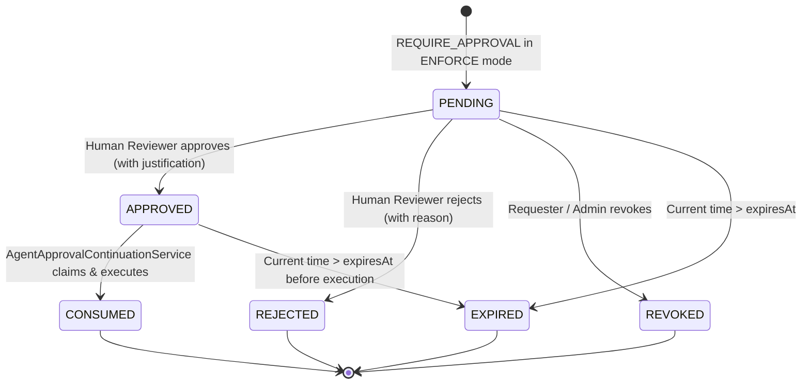

# HAZA-AIOS — Epic 22C Specification & Implementation Guide
## Enterprise Human-in-the-Loop Approval Workflows

**Epic:** Agent Governance & Security  
**Phase:** 22C  
**Branch:** `feature/epic-22-agent-governance-security`  
**Baseline Release:** `v0.21.0-epic21`  
**Target Release:** `v0.22.0-epic22`  

---

## 1. Executive Summary

Phase 22C delivers enterprise-grade Human-in-the-Loop (HITL) approval workflows for governed agent operations. It connects the Phase 22B Policy & Permission Engine with persistent approval routing, authorization enforcement, concurrency-safe lifecycle transitions, and secure single-use execution resumption.

Key capabilities delivered:
1. **Approval Domain Persistence (Migration 0033):** Tables `agent_approval_requests`, `agent_approval_decisions`, and `agent_approval_escalations`.
2. **Deterministic Lifecycle State Machine:** `PENDING` -> `APPROVED` / `REJECTED` / `EXPIRED` / `REVOKED`, and `APPROVED` -> `CONSUMED` (single-use guarantee).
3. **Reviewer Authorization Guards:** Enforces organization scoping, prevents agent self-approval, prevents requester self-approval on high/critical actions, and validates `agent.manage` permissions or explicit ownership.
4. **Policy Engine Integration:** In `ENFORCE` mode, `REQUIRE_APPROVAL` halts operations before side-effects and persists approval requests; in `MONITOR` mode, decisions are passively recorded without generating blocking gates.
5. **Secure Execution Continuation:** Re-evaluates live policies, verifies exact canonical SHA-256 payload fingerprints, and atomically claims approval tokens before executing tools or agent attempts.
6. **Expiration & Escalation Engine:** Automated expiry sweeping and routing to ownership escalation contacts (`AgentOwnershipAssignmentEntity.escalationContact`).
7. **REST APIs & Dark Premium UI Console:** 10 REST endpoints mounted under `/agent-governance/approvals`, paired with an interactive Human Approvals tab and 70%-width modal dialogs in `AgentGovernancePage.tsx`.

---

## 2. Approval Lifecycle State Machine

### State Transition Validation Matrix
| From Status | To Status | Triggered By | Validation / Pre-conditions |
|---|---|---|---|
| `*` | `PENDING` | Policy Engine / API | Unique idempotency key, valid agent and payload. |
| `PENDING` | `APPROVED` | Authorized Reviewer | Reviewer must have `agent.manage` or be agent owner. Requester self-approval blocked on high/critical risk. |
| `PENDING` | `REJECTED` | Authorized Reviewer | Reviewer permissions verified. |
| `PENDING` | `REVOKED` | Requester or Admin | Only original requesting actor or admin with `agent.manage` can revoke. |
| `PENDING` | `EXPIRED` | Expiry Sweep / System | Evaluated when `now() > expiresAt`. |
| `APPROVED` | `CONSUMED` | Continuation Service | Atomic claim. Exact canonical payload fingerprint match. Live policy re-evaluation passes. |

---

## 3. Database Schema (Migration 0033)

### Tables Added:
1. **`agent_approval_requests`**
   - `id`: char(36) PK
   - `organization_id`: char(36) NOT NULL (FK -> `organizations`)
   - `workspace_id`: char(36) (FK -> `workspaces`)
   - `agent_id`: char(36) NOT NULL (FK -> `ai_agent_definitions`)
   - `execution_id`, `correlation_id`, `trace_id`, `span_id`: varchar(120)
   - `action_type`: varchar(80) NOT NULL (`tool_execution`, `agent_execution`)
   - `action_target`: varchar(180) NOT NULL (toolKey or agent key)
   - `resource_id`: varchar(180)
   - `requesting_actor_id`: char(36) NOT NULL
   - `canonical_payload_fingerprint`: char(64) NOT NULL (SHA-256)
   - `payload`: json NOT NULL
   - `matched_policy_id`: char(36) (FK -> `agent_governance_policies`)
   - `matched_policy_version`: int
   - `approval_reason`: text NOT NULL
   - `risk_classification`: varchar(40) (`low`, `medium`, `high`, `critical`)
   - `security_classification`: varchar(40) (`public`, `internal`, `confidential`, `restricted`)
   - `assigned_reviewer_id`: char(36) (FK -> `users`)
   - `status`: varchar(40) NOT NULL (`pending`, `approved`, `rejected`, `expired`, `revoked`, `consumed`)
   - `decision_id`: char(36)
   - `consumed_at`: timestamp(3)
   - `consumed_by`: char(36)
   - `idempotency_key`: varchar(120) NOT NULL (Unique per org)
   - `expires_at`: timestamp(3) NOT NULL

2. **`agent_approval_decisions`**
   - `id`: char(36) PK
   - `approval_request_id`: char(36) NOT NULL (FK -> `agent_approval_requests`)
   - `organization_id`: char(36) NOT NULL (FK -> `organizations`)
   - `decision`: varchar(40) NOT NULL (`approved`, `rejected`, `revoked`)
   - `decided_by_actor_id`: char(36) NOT NULL (FK -> `users`)
   - `reason`: text
   - `justification`: text
   - `policy_snapshot`: json NOT NULL
   - `created_at`: timestamp(3) NOT NULL

3. **`agent_approval_escalations`**
   - `id`: char(36) PK
   - `approval_request_id`: char(36) NOT NULL (FK -> `agent_approval_requests`)
   - `organization_id`: char(36) NOT NULL (FK -> `organizations`)
   - `escalated_by_actor_id`: char(36) NOT NULL
   - `previous_reviewer_id`, `escalated_to_reviewer_id`: char(36) (FK -> `users`)
   - `escalation_contact`: varchar(255)
   - `reason`: text NOT NULL
   - `status`: varchar(40) NOT NULL (`escalated`, `resolved`)
   - `created_at`: timestamp(3) NOT NULL

---

## 4. REST API Specification

All endpoints are organization-scoped under `/api/v1/organizations/:organizationId/agent-governance/approvals`:

| Method | Endpoint | Description | Permission |
|---|---|---|---|
| `GET` | `/approvals` | Lists approval requests with status/agent/risk filtering and pagination. | `agent.read` |
| `GET` | `/approvals/:approvalId` | Retrieves complete request details with decision and escalation history. | `agent.read` |
| `POST` | `/approvals` | Manually creates an approval request. | `agent.read` |
| `POST` | `/approvals/:approvalId/approve` | Approves request with mandatory justification for high/critical risks. | `agent.read` + Reviewer Auth |
| `POST` | `/approvals/:approvalId/reject` | Rejects request with justification/reason. | `agent.read` + Reviewer Auth |
| `POST` | `/approvals/:approvalId/revoke` | Revokes pending request by requester or admin. | `agent.read` + Requester/Admin |
| `POST` | `/approvals/:approvalId/escalate` | Escalates request to supervisor or ownership escalation contact. | `agent.read` |
| `GET` | `/approvals/:approvalId/status` | Lightweight status query for polling and execution workers. | `agent.read` |
| `POST` | `/approvals/:approvalId/continue` | Resumes approved operation after verifying payload and live policies. | `agent.manage` |
| `POST` | `/approvals/expire-sweep` | Batch-sweeps and marks expired pending requests. | `agent.manage` |

---

## 5. Security & Verification Summary

- **20/20 Unit & Integration Tests Passed:** `apps/api/tests/epic22c-approval-workflows.test.ts`
- **99/99 Total Tests Passed:** Complete regression matrix across Epics 16, 19, 20, 21, 22A, 22B, and 22C.
- **Zero TypeScript Compiler Errors:** `typecheck:api` and `typecheck:web` both exited with code 0.
- **Database Schema Verified:** `npm run db:check -w apps/api` ("Everything's fine 🐶🔥").
