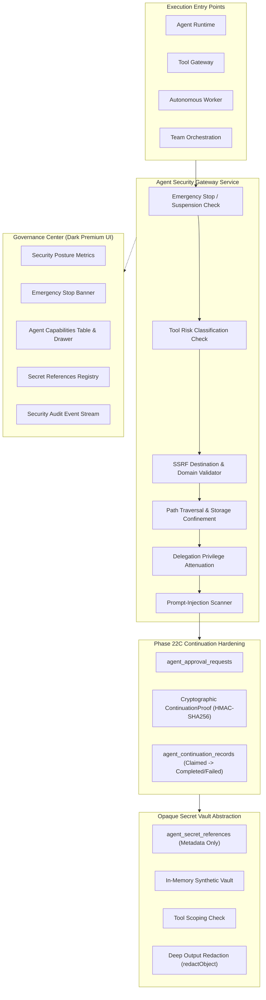

# HAZA-AIOS — Epic 22D Completion Summary
## Enterprise Agent Security Controls, Sandboxing & Secret Protection

**Epic:** Agent Governance & Security  
**Phase:** 22D  
**Repository:** `HAZA-AIOS/haza-aios`  
**Local Workspace:** `C:\HAZA-APPS\HAZA-AIOS`  
**Git Branch:** `feature/epic-22-agent-governance-security`  
**Production Baseline:** `v0.21.0-epic21`  
**Phase 22C Baseline Commit:** `357b2621`  
**Target Release:** `v0.22.0-epic22`  
**Status:** **PHASE 22D COMPLETE**

---

## 1. Executive Summary

Phase 22D establishes defense-in-depth enterprise security controls, execution sandboxing boundaries, and secret protection abstractions across the HAZA-AIOS agent platform. It hardens runtime execution entry, tool gateway dispatches, autonomous tasks, and approval continuation flows while eliminating prior vulnerabilities.

Key accomplishments:
- **Centralized Capability Model:** Agent profiles enforce strict security classifications, network/storage access modes, resource budgets, and autonomy ceilings (`L0`–`L3`).
- **Deterministic 6-Tier Tool Risk Classification:** Automatically categorizes tools into `READ_ONLY_DATA`, `CONTROLLED_WRITE`, `EXTERNAL_NETWORK`, `FILESYSTEM_ACCESS`, `CODE_EXECUTION`, and `SYSTEM_OPERATION`.
- **Honest Sandboxing Boundaries:** Untrusted arbitrary code execution (`CODE_EXECUTION`) and system operating primitives (`SYSTEM_OPERATION`) are strictly disabled and blocked by default at the platform gateway without false container-isolation claims.
- **SSRF & Path Traversal Protections:** Blocks loopback (`127.0.0.1`), private subnets (RFC1918), and cloud metadata (`169.254.169.254`). Rejects directory traversal sequences (`..`) and sensitive system directories (`/etc`, `/proc`, `C:\Windows`).
- **Zero-Storage Secret Abstraction:** Opaque secret references (`ref:xxx`) store only metadata in MySQL. Secret values exist solely in secure memory vaults (`AgentSecretVaultService`) and are scoped to authorized tools. All gateway outputs and logs are recursively scrubbed via `redactObject`.
- **Emergency Stop & Suspension Controls:** Instant organization-level kill switch and agent suspension controls halting in-flight execution at cancellation checkpoints.
- **Phase 22C Security Hardening:** Eliminated client boolean `bypassGovernanceApprovalCheck`. Replaced with HMAC-SHA256 cryptographically signed `ContinuationProof` and durable `agent_continuation_records` preventing replay attacks and ensuring crash recovery reconciliation.
- **Security Operations UI:** Dark premium Security Controls dashboard tab with posture metrics, emergency stop banner, capability management, secret reference registry, and real-time security audit event stream.
- **Database Migration 0034:** Successfully registered and validated 4 new tables: `agent_security_profiles`, `agent_secret_references`, `agent_security_events`, `agent_continuation_records`.
- **Verification:** 100% pass rate on 20 new security tests and 119/119 total tests across the regression suite (Epics 16, 19, 20, 21, 22A, 22B, 22C, 22D). Full TypeScript validation passed with 0 errors.

---

## 2. Security Defense Topology

---

## 3. Database Migration Summary (0034)

| Table Name | Description | Key Indexes / Constraints |
| :--- | :--- | :--- |
| `agent_security_profiles` | Per-agent capability boundaries, classification, network/storage permissions, budgets, and suspension status | `idx_asp_org_agent` (unique `organization_id`, `agent_id`) |
| `agent_secret_references` | Opaque metadata reference keys for secrets without storing credentials | `idx_asr_org_key` (unique `organization_id`, `secret_key`) |
| `agent_security_events` | Append-only security audit trail for suspensions, blocks, and violations | `idx_ase_org_agent` (`organization_id`, `agent_id`) |
| `agent_continuation_records` | Durable execution lifecycle and reconciliation state for approved actions | `idx_acr_approval` (unique `approval_id`) |

Migration verified with `npm run db:check -w apps/api`: `Everything's fine 🐶🔥`.

---

## 4. REST API Endpoints Implemented

13 REST endpoints mounted under `/api/v1/organizations/:organizationId/agent-governance/security/`:
1. `GET /posture` — Retrieve overall security posture, metric counts, and kill switch status.
2. `POST /emergency-stop` — Trigger emergency stop across all agents in the organization.
3. `POST /emergency-stop/resume` — Resume normal operations from emergency stop.
4. `GET /profiles` — List all agent security profiles.
5. `GET /profiles/:agentId` — Get security capability profile for a specific agent.
6. `PUT /profiles/:agentId` — Upsert/configure agent capability profile.
7. `POST /agents/:agentId/suspend` — Suspend a specific agent immediately.
8. `POST /agents/:agentId/reactivate` — Reactivate a suspended agent.
9. `GET /secrets` — List secret references (metadata only, zero secrets exposed).
10. `POST /secrets` — Register an opaque secret reference.
11. `PUT /secrets/:secretKey` — Update an opaque secret reference.
12. `DELETE /secrets/:secretKey` — Revoke/delete an opaque secret reference.
13. `GET /events` — List security audit events with pagination and filtering.

---

## 5. Automated Verification Results

- **Epic 22D Security Suite:** 20/20 passed (`tests/epic22d-security-controls.test.ts`)
- **Full Agent Regression Suite:** 119/119 passed across 8 test suites:
  - `epic22d-security-controls.test.ts` (20 passed)
  - `epic22c-approval-workflows.test.ts` (20 passed)
  - `epic22b-policy-engine.test.ts` (17 passed)
  - `epic22a-governance-foundation.test.ts` (13 passed)
  - `epic21-observability-reliability.test.ts` (12 passed)
  - `epic20-autonomous-operations.test.ts` (22 passed)
  - `epic19-orchestration.test.ts` (13 passed)
  - `epic16-agent-tools.integration.test.ts` (2 passed)
- **TypeScript Verification:**
  - `npm run typecheck:api`: 0 errors
  - `npm run typecheck:web`: 0 errors
- **Database Verification:** `npm run db:check -w apps/api`: Clean schema synchronization
