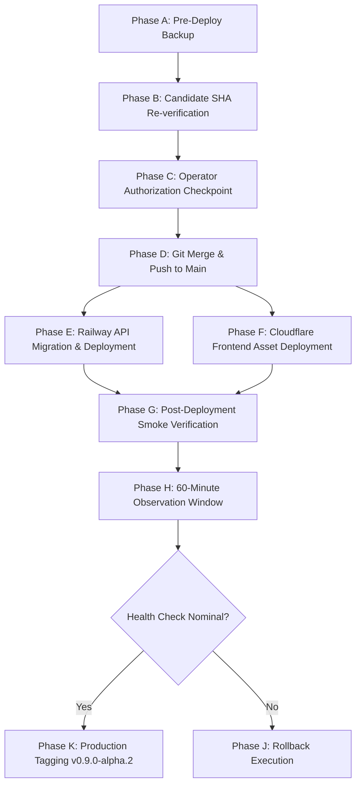

# Stage 20G.2: Production Release Dry-Run Plan & Simulation

**Repository:** `C:\HAZA-APPS\HAZA-AIOS`  
**Candidate Commit:** `627f675`  
**Target Release Tag:** `v0.9.0-alpha.2`  
**Mode:** **SIMULATION ONLY — ZERO PRODUCTION MUTATIONS EXECUTED**

---

## 1. Simulation Overview & Phasing

This dry-run models the complete sequence of operations required to transition HAZA AIOS from `v0.9.0-alpha.1` to `v0.9.0-alpha.2`. Each phase specifies the exact target environment, command syntax, expected output, verification criteria, risk level, and required human sign-offs.



---

## 2. Detailed Execution Sequence (Phases A through J)

### Phase A: Pre-Deployment Backup & Validation
- **Objective:** Capture a fresh, point-in-time SQL snapshot of the production database immediately prior to release to guard against data loss.
- **Target Environment:** Railway Production MySQL Service (`MySQL` on `production`).
- **Command / Operation:**
  ```powershell
  powershell -ExecutionPolicy Bypass -File .\scripts\backup-production.ps1
  ```
- **Expected Outcome:** New `.sql` dump file created in `C:\Users\theme\HAZA-AIOS-Private\production-backups\stage20\` alongside a `.sha256` checksum file. Exit code `0`.
- **Verification Evidence:**
  - Verify file size > 190 KB.
  - Verify SHA-256 hash matches the computed hash of the dump file.
  - Inspect line count and confirm schema headers without errors.
- **Approval Required:** Yes (pre-requisite for merge).
- **Risk Classification:** **Low** (read-only query stream via mysqldump with `--single-transaction --quick`).

---

### Phase B: Candidate Commit Confirmation
- **Objective:** Ensure the repository working tree is on the exact audited commit.
- **Target Environment:** Local Workstation (`C:\HAZA-APPS\HAZA-AIOS`).
- **Command / Operation:**
  ```bash
  git rev-parse HEAD
  git status --porcelain
  ```
- **Expected Outcome:**
  - HEAD output: `627f675df134516e984a808323758f14e5d268fb` (or latest audited documentation commit).
  - Clean working tree (zero uncommitted tracked modifications).
- **Verification Evidence:** Terminal output matches release manifest.
- **Approval Required:** Yes.
- **Risk Classification:** **None** (local read-only inspection).

---

### Phase C: Operator Authorization Checkpoint
- **Objective:** Formal operator decision gate.
- **Target Environment:** Human Operator Interface.
- **Command / Operation:** Operator types affirmative confirmation: `AUTHORIZE STAGE 20G.2 RELEASE`.
- **Expected Outcome:** Explicit authorization recorded.
- **Verification Evidence:** Chat / execution transcript log.
- **Approval Required:** **MANDATORY BLOCKING GATE**.
- **Risk Classification:** **Governance Gate**.

---

### Phase D: Planned Git Integration Sequence
- **Objective:** Fast-forward merge the validated release candidate into `main` and push to GitHub.
- **Target Environment:** GitHub Remote Repository (`HAZA-AIOS/haza-aios`).
- **Command / Operation:**
  ```bash
  git checkout main
  git pull origin main
  git merge --ff-only feature/stage-20f-regression-security-validation
  git push origin main
  ```
- **Expected Outcome:**
  - `main` advances cleanly from `ae8f0e5` to `627f675`.
  - Remote `origin/main` updated with identical commit history.
- **Verification Evidence:** `git rev-parse origin/main` outputs `627f675`.
- **Approval Required:** Yes (authorized in Phase C).
- **Risk Classification:** **Medium** (triggers automated webhooks).

---

### Phase E: Railway Migration & API Deployment Sequence
- **Objective:** Automatically execute pending migrations (0016 & 0017) and boot updated API service.
- **Target Environment:** Railway Production Environment (`production`, service `api`).
- **Command / Operation:** Triggered automatically by push to `main` via Railway GitHub App.
  - *Railway internal execution sequence:*
    1. Build: `npm install --include=dev && npm run build`
    2. Pre-deploy: `npm run db:migrate` (runs `apps/api/src/database/scripts/migrate.ts` using `mysql94-migrator.ts`)
    3. Start: `npm run start` (node `dist/server.js`)
    4. Readiness Healthcheck: Polls `GET /api/v1/readiness` (timeout 120s)
- **Expected Outcome:**
  - Migration script applies `0016_left_deathstrike` and `0017_youthful_silverclaw`.
  - `__drizzle_migrations` table gains rows 17 and 18.
  - Table `tenant_domains` created; column `verification_token` added.
  - Container health check returns HTTP 200 `{ status: "ready", database: "connected" }`.
  - Traffic routes to new container.
- **Verification Evidence:**
  - Railway Deployment Log: `database_migrations_applied` logged.
  - `curl -f https://api.haza-aios.com/api/v1/readiness` returns HTTP 200.
- **Approval Required:** Pre-authorized.
- **Risk Classification:** **High** (production schema mutation and API restart).

---

### Phase F: Cloudflare Frontend Deployment Sequence
- **Objective:** Deploy updated Vite web bundle with new domains page and SIS improvements.
- **Target Environment:** Cloudflare Edge Network (`haza-aios` Worker with Static Assets).
- **Command / Operation:** Triggered automatically by push to `main` via Cloudflare Builds (or manual CLI fallback: `npx wrangler deploy` from `apps/web`).
- **Expected Outcome:**
  - Static assets uploaded to Cloudflare storage.
  - Edge routing configured for single-page application mode (`wrangler.jsonc`).
  - Global edge propagation completed in < 15 seconds.
- **Verification Evidence:**
  - `https://www.haza-aios.com/` returns HTTP 200 with new build asset hashes.
- **Approval Required:** Pre-authorized.
- **Risk Classification:** **Low** (static asset edge deployment; zero downtime).

---

### Phase G: Post-Deployment Smoke Tests
- **Objective:** Validate end-to-end production functionality across public, authenticated, and database-backed paths.
- **Target Environment:** Live Production Endpoints (`https://api.haza-aios.com`, `https://www.haza-aios.com`).
- **Command / Operation:**
  1. API Readiness:
     ```bash
     curl -i https://api.haza-aios.com/api/v1/readiness
     ```
  2. API Health:
     ```bash
     curl -i https://api.haza-aios.com/api/v1/health
     ```
  3. Web Shell & Assets:
     ```bash
     curl -I https://www.haza-aios.com/
     ```
  4. Authenticated Smoke Tests:
     - Log in with operator admin account.
     - Verify navigation to `/dashboard`.
     - Verify `/workspace/education/students` directory loads with tenant isolation intact.
     - Verify `/workspace/settings/domains` loads the domain registration table without console errors.
- **Expected Outcome:** All HTTP responses return 200 OK. No 5xx server errors or JavaScript runtime exceptions.
- **Verification Evidence:** HTTP response headers, dashboard rendering confirmation.
- **Approval Required:** Operator verification.
- **Risk Classification:** **Low** (read-only verification).

---

### Phase H: Monitoring & Observation Period
- **Objective:** Monitor system stability under operational load.
- **Duration:** 60 minutes continuously following smoke test pass.
- **Target Metrics:**
  - HTTP 5xx error rate < 0.1%.
  - Database connection pool utilization < 40%.
  - API response latency P95 < 250ms.
  - Zero database lock contention or timeout events.
- **Approval Required:** None (passive monitoring).
- **Risk Classification:** **None**.

---

### Phase I: Abort Conditions
The release must be immediately aborted and rolled back if ANY of the following occur:
1. Railway pre-deploy migration fails with error or hangs beyond 60 seconds.
2. Container readiness healthcheck fails after 10 retries (120s timeout).
3. API logs report database connection errors or syntax exceptions.
4. HTTP 5xx error rate exceeds 1% during smoke testing or observation.
5. User authentication or session tokens fail to validate.
6. Tenant data leaks or cross-tenant visibility is observed.

---

### Phase J: Rollback & Recovery Procedure
In the event of an abort condition:

1. **API Service Instant Rollback:**
   - In Railway Dashboard -> Service `api` -> Deployments tab.
   - Locate the previous active deployment (`ae8f0e5`).
   - Click **Rollback to this deployment**.
   - Railway re-routes ingress traffic immediately to the previous container image (< 10 seconds).
2. **Frontend Instant Rollback:**
   - In Cloudflare Dashboard -> Workers & Pages -> `haza-aios` -> Deployments.
   - Click **Rollback** to previous version.
   - Takes effect globally in < 15 seconds.
3. **Database Schema Disposition:**
   - Because migrations 0016 and 0017 are strictly additive (new `tenant_domains` table and new optional column/enum values), the rolled-back API codebase (`v0.9.0-alpha.1`) remains **100% compatible** with the expanded schema.
   - Database rollback is **NOT REQUIRED** unless actual data corruption occurred.
   - If emergency database restoration is mandated, follow `STAGE-20G2-ROLLBACK-RECOVERY-PLAN.md`.
